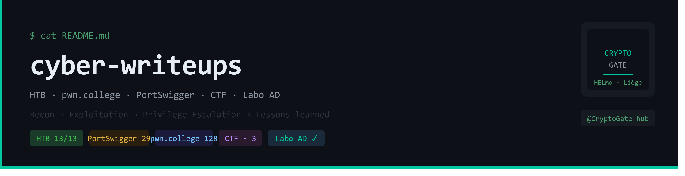

  

  

  
  
  
  
  

---

Writeups HTB · PortSwigger · pwn.college · CTF — chaînes d'attaque, commandes complètes, leçons retenues.
Toutes les machines sont **retired**. Writeups à but strictement éducatif.

> 👉 **Meilleure expérience de lecture : [cryptogate-hub.github.io/cyber-writeups](https://cryptogate-hub.github.io/cyber-writeups)**

---

## ⚡ Writeups phares

| Writeup | Pourquoi le lire |
|---|---|
| [🟢 Reactor](https://cryptogate-hub.github.io/cyber-writeups/htb/machines/reactor/) | RCE CVE-2025-55182 (React/Next.js) + privesc Node.js `--inspect` |
| [🟢 Nexus](https://cryptogate-hub.github.io/cyber-writeups/htb/machines/nexus/) | Gitea credential leak + RCE CRM + directory traversal git objects |
| [🔎 Campfire-1](https://cryptogate-hub.github.io/cyber-writeups/htb/sherlocks/campfire-1/) | DFIR complet — Kerberoasting via EVTX Sysmon/PowerShell |
| [🚀 Unified](https://cryptogate-hub.github.io/cyber-writeups/htb/starting-point/labs/13-unified/) | Log4Shell de bout en bout, du JNDI à la privesc MongoDB |

---

## 📁 Structure
