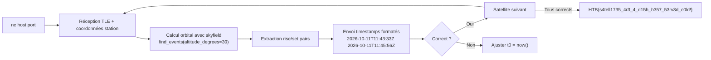

[⬅ Retour à Challenges](README.md) · [🏠 Accueil du repo](../../README.md)

# First Contact — Misc (Very Easy)

| | |
|---|---|
| **Catégorie** | Misc |
| **Difficulté** | Very Easy |
| **Récompense** | 130 XP |

## Scénario

> A software update knocked the ground station's automated pass prediction system offline just before a scheduled communications window. The operations team still has the satellite's latest TLEs and the station's coordinates, but they need you to manually determine when the satellite will be above the horizon and visible from the ground station. Calculate the visibility windows so contact can be re-established before the next scheduled transmission is missed.

Le service envoie des TLEs et des coordonnées de station sol. Il faut calculer les fenêtres de visibilité du satellite (élévation > 30°) pour les prochaines 24h et répondre en temps réel, pour plusieurs satellites successifs.

## Flux de résolution



## Solution

### Analyse du service

Le service TCP envoie des paires TLE + coordonnées station sol pour plusieurs satellites consécutifs. Il faut répondre avec les fenêtres de visibilité sous forme de timestamps UTC espacés (`rise set rise set ...`). Le service timeout rapidement — impossible de calculer manuellement à temps.

### Pièges rencontrés

- Coller le script Python dans le terminal nc → le nc le prend comme input et répond `Invalid isoformat string`
- `t0` hardcodé à minuit → les timestamps calculés ne correspondent pas à la fenêtre courante
- `day + 1` pour calculer t1 → débordement de mois/an, timestamps dans le désordre
- `find_events` peut retourner un set sans rise précédent si le satellite est déjà au-dessus de l'horizon au démarrage → filtrer les paires incomplètes

### Script final (automatisé)

```python
import socket
import re
from skyfield.api import EarthSatellite, Topos, load
from datetime import datetime, timezone, timedelta

ts = load.timescale()

def calc_windows(line1, line2, lat, lon):
    sat = EarthSatellite(line1, line2, "DIGITWIN HTB", ts)
    station = Topos(latitude_degrees=lat, longitude_degrees=lon)
    now = datetime.now(timezone.utc)
    t0 = ts.from_datetime(now)
    t1 = ts.from_datetime(now + timedelta(hours=24))
    times, events = sat.find_events(station, t0, t1, altitude_degrees=30)

    windows = []
    current_rise = None
    for ti, event in zip(times, events):
        if event == 0:
            current_rise = ti.utc_iso()
        elif event == 2 and current_rise is not None:
            windows.append(f"{current_rise} {ti.utc_iso()}")
            current_rise = None

    return " ".join(windows)

s = socket.socket()
s.connect(("154.57.164.78", 32341))
s.settimeout(15)

data = b""
while True:
    try:
        chunk = s.recv(4096)
        if not chunk:
            break
        data += chunk
        print(chunk.decode(errors="ignore"), end="")
        text = data.decode(errors="ignore")

        tle_match = re.search(r"(1 \d{5}U.*)\n(2 \d{5}.*)", text)
        loc_match = re.search(r"\(Lat,Long\):\s*([-\d.]+),([-\d.]+)", text)

        if tle_match and loc_match and "When will it be visible" in text:
            line1 = tle_match.group(1).strip()
            line2 = tle_match.group(2).strip()
            lat = float(loc_match.group(1))
            lon = float(loc_match.group(2))

            answer = calc_windows(line1, line2, lat, lon)
            print(f"\n>>> Sending: {answer}")
            s.sendall((answer + "\n").encode())
            data = b""

    except socket.timeout:
        print("\n[timeout]")
        break

s.close()
```

### Points clés

- `skyfield` — bibliothèque Python de mécanique orbitale, gère les TLEs nativement
- `find_events(altitude_degrees=30)` — retourne les événements rise (0), culmination (1), set (2) pour un seuil d'élévation donné
- `t0 = ts.from_datetime(now)` — fenêtre glissante depuis l'instant présent, pas depuis minuit
- Paires rise/set reconstruites manuellement pour éviter les sets orphelins en début de fenêtre
- Connexion TCP automatisée avec `socket` pour éviter le timeout du service

## Flag

```
HTB{s4tell1735_4r3_4_d15h_b357_53rv3d_c0ld!}
```
