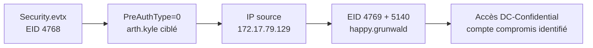

[⬅ Retour à Sherlocks](README.md) · [🏠 Accueil du repo](../../README.md)

# Campfire-2 — DFIR (Very Easy)

| | |
|---|---|
| **Catégorie** | DFIR |
| **Difficulté** | Very Easy |
| **Récompense** | 150 XP |
| **Artefacts** | `Security.evtx` |

## Scénario

> Forela's Network is constantly under attack. The security system raised an alert about an old admin account requesting a ticket from KDC on a domain controller. Inventory shows that this user account is not used as of now so you are tasked to take a look at this. This may be an AsREP roasting attack as anyone can request any user's ticket which has preauthentication disabled.

## Artefacts fournis

| Fichier | Description |
|---|---|
| `Security.evtx` | Journal de sécurité du contrôleur de domaine `DC01.forela.local` |

> L'archive est protégée par un mot de passe (`hacktheblue`) et chiffrée en AES : il faut **7-Zip** pour l'extraire (`7z x campfire-2.zip -ocampfire-2`), `unzip` ne gère pas la méthode de compression 99.

## Outils

- **python-evtx** (`pip install evtx`) : parsing des `.evtx` sur Linux

## Flux de résolution



## Rappel — AS-REP Roasting

L'AS-REP Roasting cible les comptes dont la **pré-authentification Kerberos est désactivée** (`PreAuthType = 0`). Sans pré-auth, n'importe qui peut demander un TGT pour ce compte au KDC — le KDC répond avec un AS-REP chiffré avec le hash du mot de passe de l'utilisateur. L'attaquant récupère ce blob chiffré et le craque hors ligne.

Indicateurs dans les logs :

| Champ | Valeur suspecte | Pourquoi |
|---|---|---|
| `EventID` | `4768` | Demande de TGT (AS-REQ) |
| `PreAuthType` | `0` | Pré-auth désactivée = compte vulnérable |
| `TicketEncryptionType` | `0x17` (RC4) | Chiffrement faible, craquable hors ligne |
| `IpAddress` | IP externe non-`::1` | Demande depuis une machine distante |

## Solution pas à pas

### Parsing des logs sur Linux

```bash
7z x campfire-2.zip -ocampfire-2   # mot de passe : hacktheblue
pip install evtx --break-system-packages

python3 -c "
import evtx
parser = evtx.PyEvtxParser('campfire-2/Security.evtx')
for record in parser.records():
    if '4768' in record['data']:
        print(record['data'])
        print('---')
"
```

### Task 1 — Timestamp de l'attaque

Parmi tous les événements 4768, un seul a `PreAuthType=0` et une IP externe :

```
TimeCreated: 2024-05-29T06:36:40Z
TargetUserName: arthur.kyle
PreAuthType: 0
IpAddress: ::ffff:172.17.79.129
```

**Réponse : `2024-05-29 06:36:40`**

### Task 2 — Compte ciblé

**Réponse : `arthur.kyle`**

### Task 3 — SID du compte ciblé

Visible dans le même événement 4768 :

**Réponse : `S-1-5-21-3239415629-1862073780-2394361899-1601`**

### Task 4 — IP de la machine attaquante

Extraite du champ `IpAddress: ::ffff:172.17.79.129` (format IPv4-mapped IPv6).

**Réponse : `172.17.79.129`**

### Task 5 — Compte compromis utilisé pour l'attaque

Recherche de tous les événements impliquant `172.17.79.129` :

```bash
python3 -c "
import evtx
parser = evtx.PyEvtxParser('campfire-2/Security.evtx')
for record in parser.records():
    d = record['data']
    if '172.17.79.129' in d:
        print(d)
        print('---')
"
```

On trouve des événements **4769** (demande de ticket de service) et **5140** (accès réseau à un partage) avec `SubjectUserName: happy.grunwald`, depuis la même IP, juste après l'AS-REP roasting. Ce compte a également accédé au share `DC-Confidential`.

**Réponse : `happy.grunwald`**

## Résumé des réponses

| Task | Question | Réponse |
|------|----------|---------|
| 1 | Timestamp de l'attaque | `2024-05-29 06:36:40` |
| 2 | Compte ciblé | `arthur.kyle` |
| 3 | SID du compte ciblé | `S-1-5-21-3239415629-1862073780-2394361899-1601` |
| 4 | IP de la machine attaquante | `172.17.79.129` |
| 5 | Compte compromis ayant lancé l'attaque | `happy.grunwald` |
