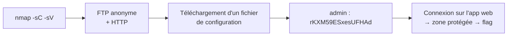

[⬅ Retour à Starting Point](../README.md) · [🏠 Accueil du repo](../../../README.md)

# Machine 7 — Oasis

**Fuite de credentials via FTP → Web — Ports 21, 80**

| | |
|---|---|
| **Tier** | 1 |
| **OS** | Linux |
| **Services** | FTP (21) · HTTP (80) |

## Concept

Illustrer comment une fuite d'identifiants sur un service annexe (FTP) permet de compromettre un service principal (application web).



## Méthodologie

### Scan de ports

```bash
nmap -sV -sC 10.129.x.x
```

```
21/tcp open  ftp
80/tcp open  http
```

### Accès FTP anonyme

```bash
ftp 10.129.x.x
```

```
Name: anonymous
Password: (vide)
```

Téléchargement d'un fichier de configuration contenant des identifiants :

```
admin / rKXM59ESxesUFHAd
```

### Connexion à l'application web

Connexion avec ces identifiants sur le site web → accès à la zone protégée contenant le flag.

## Points clés

- Une fuite de credentials via un service secondaire (FTP) compromet souvent un service principal (web).
- Toujours croiser les informations trouvées entre les différents services ouverts sur une même cible.

## Leçon retenue

*Ne jamais stocker d'identifiants en clair dans des fichiers accessibles, même sur des services jugés secondaires.*

---

[⬅ Précédent : Sequel](06-sequel.md) · [⬆ Index Starting Point](../README.md) · [Suivant : Responder ➡](08-responder.md)
