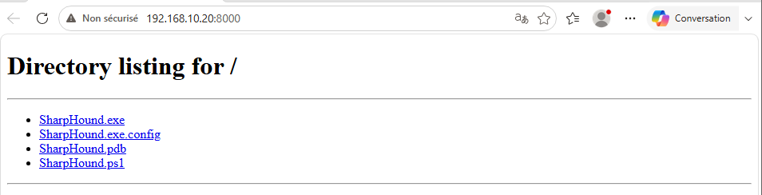

# 🟣 Purple Team AD Lab — Reconnaissance BloodHound & chaîne d'attaque

> **Auteur :** CryptoGate
> **Date :** Novembre 2026
> **Catégorie :** Active Directory | Red Team | Blue Team
> **MITRE ATT&CK :** T1558.004 (AS-REP Roasting) · T1558.003 (Kerberoasting) · T1021.002 (SMB) · T1003.001 (LSASS)

Ce labo étend le [Kerberoasting + Wazuh](ad-kerberoasting.md) existant en un **Purple Team AD Lab** complet : reconnaissance BloodHound, construction d'une chaîne d'attaque réaliste zero-to-DomainAdmin, et documentation honnête des blocages rencontrés — y compris ceux non résolus par la voie normale.

---

## 📋 Table des matières

1. [Objectifs & topologie](#objectifs)
2. [Préparation des comptes cibles](#preparation)
3. [Reconnaissance BloodHound / SharpHound](#reconnaissance)
4. [Construction d'une chaîne d'attaque réaliste](#chaine)
5. [Incident de collecte : NetSessionEnum bloqué](#incident)
6. [Résolution et chemin d'attaque complet](#resolution)
7. [Conclusion & suite](#conclusion)

---

## 1. Objectifs & topologie <a name="objectifs"></a>

Prolonger le labo Kerberoasting existant avec une reconnaissance **BloodHound/SharpHound**, puis construire une chaîne d'attaque complète (compte non privilégié → Domain Admin), le tout documenté pour un dépôt de candidature stage sécurité offensive.

### Topologie

| Machine | Rôle | IP |
|---|---|---|
| DC01 | Windows Server 2022 — AD DS, DNS | 192.168.10.1 |
| WIN11 | Windows 11 Pro — poste membre | 192.168.10.10 |
| Kali Linux | Attaquant | 192.168.10.20 |
| Wazuh | SIEM | — |

Hyperviseur : VMware Workstation, réseau NAT `192.168.10.0/24`.

---

## 2. Préparation des comptes cibles <a name="preparation"></a>

Deux comptes volontairement faibles ont été créés pour servir de cibles d'attaque réalistes.

### `svc_legacy` — cible AS-REP Roasting

Le mécanisme Kerberos impose normalement une **pré-authentification** : avant de répondre, le KDC exige que le client prouve qu'il connaît déjà le mot de passe (timestamp chiffré). Le flag `DONT_REQ_PREAUTH` (bit `0x400000` de `userAccountControl`) désactive cette vérification — un attaquant peut alors obtenir un blob chiffré avec la clé dérivée du mot de passe, sans rien connaître au préalable, et le casser hors ligne.

```powershell
Get-ADUser -Identity svc_legacy -Properties userAccountControl | Select-Object Name, userAccountControl
# -> 4260352 (66048 base + 4194304 DONT_REQ_PREAUTH)

$uac = 4260352
if ($uac -band 0x400000) { "DONT_REQ_PREAUTH is ON" } else { "DONT_REQ_PREAUTH is OFF" }
# -> DONT_REQ_PREAUTH is ON
```

### `svc_sql` — cible Kerberoasting

Un compte avec un **SPN** (Service Principal Name) enregistré est éligible au Kerberoasting : n'importe quel utilisateur authentifié peut demander un ticket de service (`TGS-REQ`) chiffré avec le hash du mot de passe du compte de service, et le casser hors ligne.

```powershell
setspn -A MSSQLSvc/sqlserver01.labo.local:1433 svc_sql
setspn -L svc_sql
# -> MSSQLSvc/sqlserver01.labo.local:1433
```

---

## 3. Reconnaissance BloodHound / SharpHound <a name="reconnaissance"></a>

### Installation

BloodHound CE est déployé via Docker Compose (config officielle SpecterOps) sur Kali :

```bash
mkdir ~/bloodhound-ce && cd ~/bloodhound-ce
wget https://ghst.ly/getbhce -O docker-compose.yml
sudo docker compose up -d
sudo docker compose logs bloodhound | grep -i "password"
```


### Collecte SharpHound

SharpHound (binaire compilé, pas le code source) est exécuté depuis WIN11 avec les droits domaine, puis transféré vers Kali par partage SMB :

```powershell
.\SharpHound.exe
```

Collecte complète : 307 objets (users, computers, groups, GPOs, OUs, trusts, ACLs).



!!! warning "Windows Defender a bloqué l'exécutable"
    SharpHound est détecté comme `HackTool` par Windows Defender (comportement attendu — c'est un outil de pentest). Pour le labo, une exclusion de dossier a été ajoutée volontairement, documentée comme telle plutôt que de désactiver la protection globalement.


### Import et premières explorations

Après import du zip dans BloodHound (**Quick Upload**), le nœud domaine `LABO.LOCAL` est exploré, classé automatiquement en **Tier Zero** :


Relations directes du domaine : groupes `Admins du domaine`, `Administrators`, `Enterprise Domain Controllers` avec leurs droits respectifs (`GenericAll`, `WriteDacl`, `GetChanges`/`GetChangesAll` — ce dernier combo permettant un DCSync si accordé à un compte non-DC) :


### Premier Pathfinding — aucun chemin trouvé

Recherche d'un chemin d'escalade par abus ACL depuis les comptes faibles vers `Admins du domaine` :


**Résultat : `path not found`** pour `svc_sql` comme pour `svc_legacy`. Conclusion correcte à ce stade : aucune mauvaise configuration ACL préexistante ne permet une escalade directe — cohérent, puisque seuls le Kerberoasting/AS-REP ont été préparés, pas de faille de permission.

---
