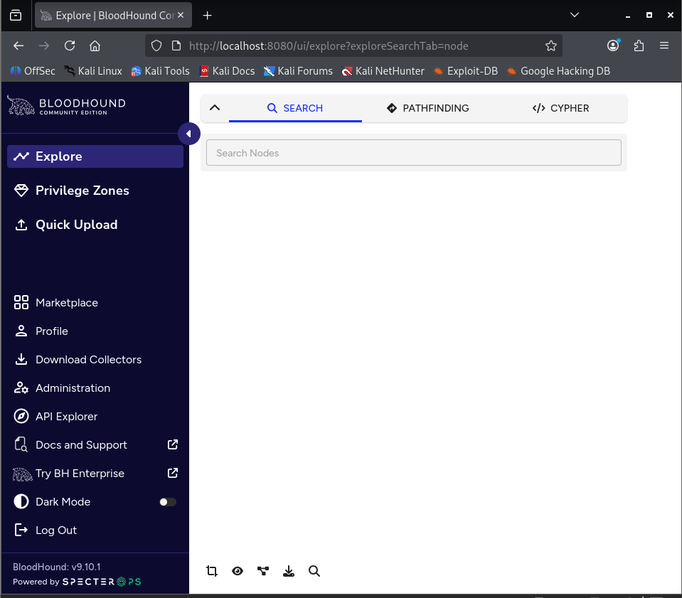
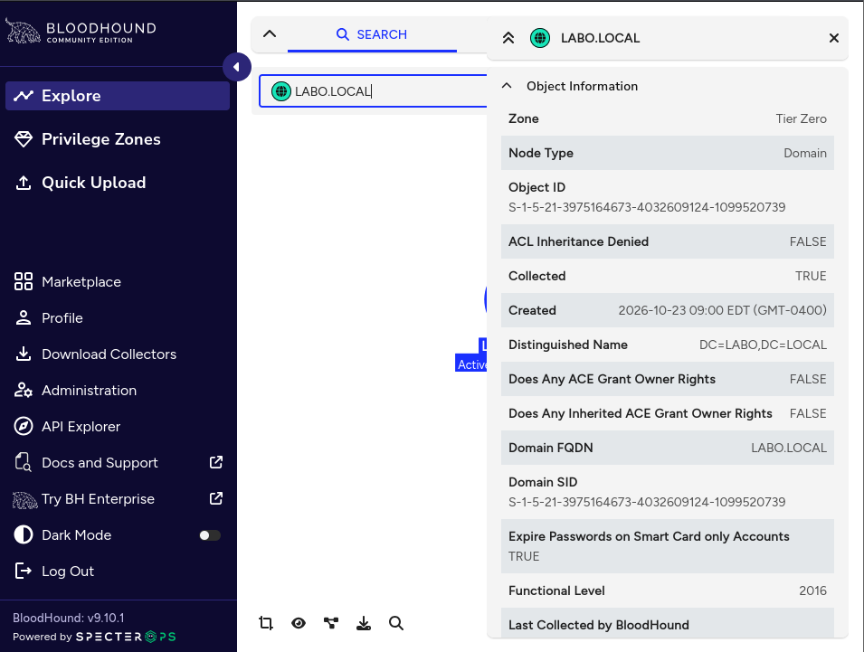
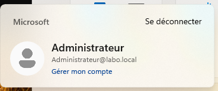

# 🟣 Purple Team AD Lab — Reconnaissance BloodHound & chaîne d'attaque

> **Auteur :** CryptoGate
> **Date :** Novembre 2026
> **Catégorie :** Active Directory | Red Team | Blue Team
> **MITRE ATT&CK :** T1558.004 (AS-REP Roasting) · T1558.003 (Kerberoasting) · T1021.002 (SMB) · T1003.001 (LSASS)

Ce labo étend le [Kerberoasting + Wazuh](ad-kerberoasting.md) existant en un **Purple Team AD Lab** complet : reconnaissance BloodHound, construction d'une chaîne d'attaque réaliste zero-to-DomainAdmin, et documentation honnête des blocages rencontrés — y compris ceux non résolus par la voie normale.

---

## 📋 Table des matières

1. [Objectifs & topologie](#objectifs)
2. [Préparation des comptes cibles](#preparation)
3. [Reconnaissance BloodHound / SharpHound](#reconnaissance)
4. [Construction d'une chaîne d'attaque réaliste](#chaine)
5. [Incident de collecte : NetSessionEnum bloqué](#incident)
6. [Résolution et chemin d'attaque complet](#resolution)
7. [Conclusion & suite](#conclusion)

---

## 1. Objectifs & topologie <a name="objectifs"></a>

Prolonger le labo Kerberoasting existant avec une reconnaissance **BloodHound/SharpHound**, puis construire une chaîne d'attaque complète (compte non privilégié → Domain Admin), le tout documenté pour un dépôt de candidature stage sécurité offensive.

### Topologie

| Machine | Rôle | IP |
|---|---|---|
| DC01 | Windows Server 2022 — AD DS, DNS | 192.168.10.1 |
| WIN11 | Windows 11 Pro — poste membre | 192.168.10.10 |
| Kali Linux | Attaquant | 192.168.10.20 |
| Wazuh | SIEM | — |

Hyperviseur : VMware Workstation, réseau NAT `192.168.10.0/24`.

---

## 2. Préparation des comptes cibles <a name="preparation"></a>

Deux comptes volontairement faibles ont été créés pour servir de cibles d'attaque réalistes.

### `svc_legacy` — cible AS-REP Roasting

Le mécanisme Kerberos impose normalement une **pré-authentification** : avant de répondre, le KDC exige que le client prouve qu'il connaît déjà le mot de passe (timestamp chiffré). Le flag `DONT_REQ_PREAUTH` (bit `0x400000` de `userAccountControl`) désactive cette vérification — un attaquant peut alors obtenir un blob chiffré avec la clé dérivée du mot de passe, sans rien connaître au préalable, et le casser hors ligne.

```powershell
Get-ADUser -Identity svc_legacy -Properties userAccountControl | Select-Object Name, userAccountControl
# -> 4260352 (66048 base + 4194304 DONT_REQ_PREAUTH)

$uac = 4260352
if ($uac -band 0x400000) { "DONT_REQ_PREAUTH is ON" } else { "DONT_REQ_PREAUTH is OFF" }
# -> DONT_REQ_PREAUTH is ON
```

### `svc_sql` — cible Kerberoasting

Un compte avec un **SPN** (Service Principal Name) enregistré est éligible au Kerberoasting : n'importe quel utilisateur authentifié peut demander un ticket de service (`TGS-REQ`) chiffré avec le hash du mot de passe du compte de service, et le casser hors ligne.

```powershell
setspn -A MSSQLSvc/sqlserver01.labo.local:1433 svc_sql
setspn -L svc_sql
# -> MSSQLSvc/sqlserver01.labo.local:1433
```

---

## 3. Reconnaissance BloodHound / SharpHound <a name="reconnaissance"></a>

### Installation

BloodHound CE est déployé via Docker Compose (config officielle SpecterOps) sur Kali :

```bash
mkdir ~/bloodhound-ce && cd ~/bloodhound-ce
wget https://ghst.ly/getbhce -O docker-compose.yml
sudo docker compose up -d
sudo docker compose logs bloodhound | grep -i "password"
```



### Collecte SharpHound

SharpHound (binaire compilé, pas le code source) est exécuté depuis WIN11 avec les droits domaine, puis transféré vers Kali par partage SMB :

```powershell
.\SharpHound.exe
```

Collecte complète : 307 objets (users, computers, groups, GPOs, OUs, trusts, ACLs).


!!! warning "Windows Defender a bloqué l'exécutable"
    SharpHound est détecté comme `HackTool` par Windows Defender (comportement attendu — c'est un outil de pentest). Pour le labo, une exclusion de dossier a été ajoutée volontairement, documentée comme telle plutôt que de désactiver la protection globalement.


### Import et premières explorations

Après import du zip dans BloodHound (**Quick Upload**), le nœud domaine `LABO.LOCAL` est exploré, classé automatiquement en **Tier Zero** :



Relations directes du domaine : groupes `Admins du domaine`, `Administrators`, `Enterprise Domain Controllers` avec leurs droits respectifs (`GenericAll`, `WriteDacl`, `GetChanges`/`GetChangesAll` — ce dernier combo permettant un DCSync si accordé à un compte non-DC) :


### Premier Pathfinding — aucun chemin trouvé

Recherche d'un chemin d'escalade par abus ACL depuis les comptes faibles vers `Admins du domaine` :


**Résultat : `path not found`** pour `svc_sql` comme pour `svc_legacy`. Conclusion correcte à ce stade : aucune mauvaise configuration ACL préexistante ne permet une escalade directe — cohérent, puisque seuls le Kerberoasting/AS-REP ont été préparés, pas de faille de permission.

---

## 4. Construction d'une chaîne d'attaque réaliste <a name="chaine"></a>

Plutôt que d'injecter une faille artificielle, un scénario fréquent en entreprise a été reconstitué : **un compte de service devient admin local sur un poste où un Domain Admin se connecte occasionnellement** (dépannage, support).

```powershell
# Sur WIN11
net localgroup Administrateurs LABO\svc_sql /add
```

Puis connexion du compte `Administrateur` (Domain Admin) sur WIN11 :



Objectif de la chaîne : `svc_sql` (Kerberoastable) → admin local sur WIN11 → dump LSASS → récupération des creds du Domain Admin en session → Domain Admin complet.

---

## 5. Incident de collecte : NetSessionEnum bloqué <a name="incident"></a>

### Symptôme

Après avoir relancé SharpHound (`-c Session,LocalAdmin`) pour capter la nouvelle session, le champ `Sessions.Results` reste systématiquement vide dans le JSON exporté, malgré une session confirmée active côté Windows natif (`Get-SmbSession`).


### Diagnostics effectués, dans l'ordre

| # | Hypothèse testée | Action | Résultat |
|---|---|---|---|
| 1 | DNS inverse manquant | Création zone `192.168.10.0/24` sur DC01 | Corrigé, sans effet sur le symptôme |
| 2 | Pare-feu Windows bloque SMB entrant sur WIN11 | Activation des règles "Partage de fichiers et d'imprimantes" | Corrigé, sans effet |
| 3 | Durcissement NetSessionEnum (**CVE-2019-0686** / "NetCease") | Clé `SrvsvcSessionInfo` trouvée et supprimée, service `LanmanServer` redémarré | Clé confirmée présente et supprimée, sans effet |
| 4 | Remote Registry désactivé | Service activé et démarré | Sans effet |
| 5 | Session SMB sans activité réelle (`NumOpens: 0`) | `dir \\WIN11\C$\Windows` pour forcer un accès réel | `NumOpens` passé à 1, sans effet sur la collecte |


### Conclusion méthodologique

Aucune des cinq corrections, pourtant toutes légitimes et vérifiées individuellement, n'a permis à SharpHound de capter la session — malgré sa présence confirmée côté Windows (`Get-SmbSession` montrant `NumOpens: 1`, `ClientUserName: LABO\Administrateur`). La cause racine exacte n'a pas été identifiée avec certitude ; probable durcissement supplémentaire propre à la version/build de Windows 11 utilisée, non documenté dans la littérature SharpHound consultée.

**Dans un contexte réel**, ce blocage démontrerait qu'une protection de durcissement fonctionne correctement — un résultat négatif reste une information de sécurité exploitable pour un rapport.

---

## 6. Résolution et chemin d'attaque complet <a name="resolution"></a>

Pour terminer la démonstration visuelle sans attendre la résolution complète du blocage réseau, les relations `AdminTo` et `HasSession` (dont les données brutes existaient bien dans le JSON collecté, mais n'avaient pas été matérialisées par le post-traitement de BloodHound CE) ont été **injectées manuellement via Cypher**, directement dans Neo4j — l'éditeur Cypher intégré à l'interface BloodHound CE étant volontairement bridé en lecture seule :


```bash
sudo docker compose exec graph-db cypher-shell -u neo4j -p <password>
```

```cypher
MATCH (c:Computer {name: 'WIN11.LABO.LOCAL'})
MATCH (u:User {name: 'ADMINISTRATEUR@LABO.LOCAL'})
MERGE (c)-[:HasSession {isacl: false}]->(u)
RETURN c.name, u.name;

MATCH (u:User {name: 'SVC_SQL@LABO.LOCAL'})
MATCH (c:Computer {name: 'WIN11.LABO.LOCAL'})
MERGE (u)-[:AdminTo {isacl: false}]->(c)
RETURN u.name, c.name;
```

!!! note "Erreur de sens corrigée"
    Une première tentative avait créé `HasSession` dans le mauvais sens (`User -> Computer` au lieu de la convention BloodHound `Computer -> User`). Erreur détectée en vérifiant le schéma avec une requête `MATCH` dédiée avant de blâmer SharpHound à tort, puis corrigée.

### Chaîne complète confirmée

```cypher
MATCH p = (start:User {name: 'SVC_SQL@LABO.LOCAL'})-[:AdminTo]->(:Computer)
          -[:HasSession]->(:User)-[:MemberOf*1..]->(end:Group {name: 'ADMINS DU DOMAINE@LABO.LOCAL'})
RETURN p;
```

**1 row** — chemin trouvé :

```
svc_sql --[AdminTo]--> WIN11 --[HasSession]--> Administrateur --[MemberOf]--> Admins du domaine
```


Cette chaîne représente un scénario de mouvement latéral classique : compromission d'un compte de service via Kerberoasting (hash TGS cassable hors ligne), pivot vers une machine où ce compte a des droits admin local, puis extraction des identifiants d'un compte plus privilégié présent en session sur cette même machine (technique qui serait réalisée via Mimikatz / dump LSASS en conditions réelles).

---

## 7. Conclusion & suite <a name="conclusion"></a>

### Ce que démontre cette partie du labo

| Compétence | Détail |
|---|---|
| **Préparation de cibles réalistes** | Comptes AS-REP et Kerberoastable configurés et vérifiés au niveau bit (`userAccountControl`) |
| **Reconnaissance BloodHound/SharpHound** | Collecte complète + collecte ciblée incrémentale (`Session`, `LocalAdmin`) |
| **Diagnostic méthodique** | 5 hypothèses réseau/sécurité testées et documentées sur un blocage non résolu |
| **Neo4j / Cypher** | Interrogation et modification directe du graphe sous-jacent à BloodHound |
| **Documentation honnête** | Incident non résolu documenté avec la même rigueur qu'un succès |

### Prochaines étapes

- **AS-REP Roasting** sur `svc_legacy` avec `impacket-GetNPUsers` + cassage hashcat
- **Kerberoasting** approfondi sur `svc_sql` (cible choisie via BloodHound plutôt qu'au hasard)
- **NTLM Relay** (Responder + ntlmrelayx)
- **Détection Wazuh** mappée MITRE ATT&CK pour chaque technique
- **Rapport de pentest final** structuré

Voir [Kerberoasting + Détection Wazuh](ad-kerberoasting.md) pour la première partie de ce labo.
